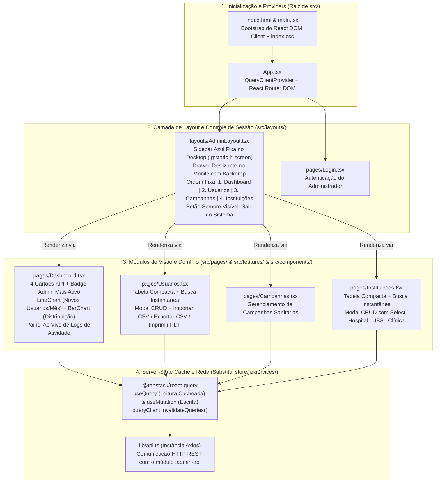
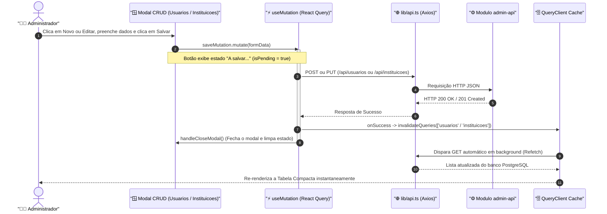
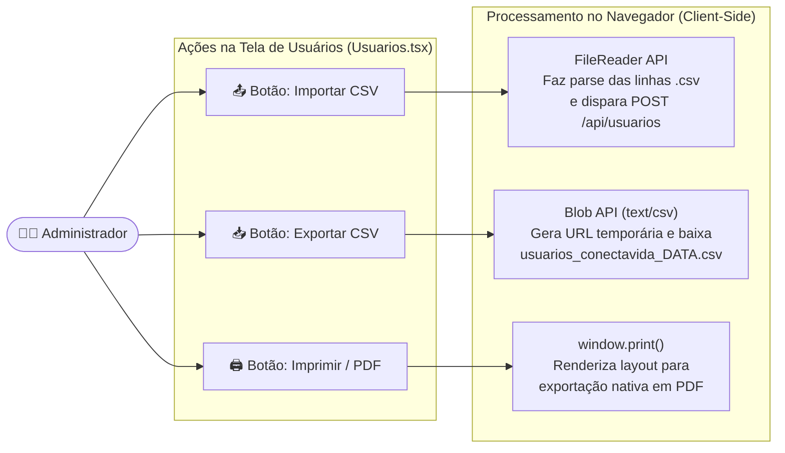

# 💻 Especificação Técnica e Guia de Arquitetura do Painel Administrador (`Conecta-Vida-Admin`)

**Diretório do Projeto:** `Conecta-Vida-Admin/conecta-vida-admin`[cite: 2, 4]  
**Branches Registradas:** `main`, `conecta-vida-admin-V2`[cite: 2]  
**Stack de Engenharia:** React + TypeScript + Vite (Rolldown) + Tailwind CSS + TanStack React Query + Recharts + Axios + Lucide React + Oxlint[cite: 2]  
**Padrão Arquitetural:** Arquitetura Híbrida (*Feature-Based* + *Layered Scaffolding*) orientada a *Server-State Cache*[cite: 2, 4]

---

## 1. Visão Arquitetural da Aplicação Frontend (Por que usamos esta Arquitetura?)

O **Conecta-Vida-Admin** é uma Single Page Application (SPA) desenvolvida em **React** e **TypeScript**, projetada para operadores e gestores de saúde pública[cite: 2]. 

Diferente da arquitetura tradicional (como o padrão MVC clássico do React ou arquiteturas baseadas em Redux/Context API onde todas as chamadas HTTP precisam passar por `services` $\rightarrow$ `actions` $\rightarrow$ `reducers` $\rightarrow$ `store` antes de chegar na tela), este projeto adota uma **Arquitetura Moderna Orientada a *Server-State* combinada com *Enterprise Scaffolding***[cite: 2, 4].

### 1.1. Os 4 Pilares desta Arquitetura (Guia para a Equipe)

1. **Separação Estrita entre *Server State* e *Client State* (Por que não usamos Redux/Store global para a API):**
   * **Server State (Estado do Servidor):** Todos os dados que vêm do backend Spring Boot (usuários, instituições, campanhas, métricas e logs do dashboard) pertencem ao servidor. Em vez de duplicá-los manualmente dentro da pasta `store/`, utilizamos o **TanStack React Query (`@tanstack/react-query`)**[cite: 2]. Ele gerencia automaticamente o cache em memória, o estado de carregamento (`isLoading`, `isPending`), o tratamento de erros e a atualização automática das tabelas após cadastros ou exclusões (`invalidateQueries`).
   * **Client State (Estado Local de UI):** Estados puramente visuais e passageiros (como se um modal está aberto ou fechado, qual texto está digitado na barra de pesquisa ou os campos de um formulário antes de salvar) ficam isolados dentro da própria página via `useState`.
2. **Co-localização Pragmática (*Co-location*) vs. Camadas Vazias:**
   * Na criação do projeto, foi gerado um **esqueleto corporativo completo (*Enterprise Folder Scaffolding*)** dentro de `src/` contendo 12 pastas padronizadas (`assets`, `components`, `config`, `features`, `hooks`, `layouts`, `lib`, `pages`, `routes`, `services`, `store`, `utils`)[cite: 4].
   * Para evitar *over-engineering* (excesso de arquivos pequenos espalhados sem necessidade), as chamadas de leitura (`useQuery`) e escrita (`useMutation`) consomem diretamente a instância central do Axios (`src/lib/api.ts`) dentro das páginas (`src/pages/`) ou módulos de domínio (`src/features/`)[cite: 2, 4]. Por esse motivo, pastas como `services/`, `store/` e `routes/` permanecem vazias como **pontos de extensão reservados** para quando o projeto escalar[cite: 4].
3. **Estabilidade Geométrica e Resiliência contra *Overflow*:**
   * Painéis administrativos com gráficos SVG (**Recharts**)[cite: 2] e listas de auditoria ao vivo costumam quebrar o layout ao aplicar zoom ou redimensionar a janela. Esta arquitetura resolve isso aplicando contenção flexível (`min-w-0` e `overflow-x-hidden`) em todos os containers estruturais e tabelas compactas de alta densidade (`text-xs`).
4. **Navegação Persistente Baseada em Viewport (`h-screen`):**
   * A barra lateral (`AdminLayout.tsx`) é desacoplada da rolagem do documento principal. Enquanto o conteúdo das tabelas rola livremente para exibir milhares de registros, o menu lateral permanece travado na altura da tela (`h-screen`), garantindo que o botão **"Sair do Sistema"** esteja sempre acessível no canto inferior esquerdo.

---

## 2. Mapeamento e Propósito de Cada Pasta no Projeto

Esta seção documenta tanto a raiz do repositório quanto cada uma das **12 pastas e 4 arquivos base dentro de `src/`**[cite: 2, 4], explicando para toda a equipe quais diretórios concentram o código atual e para que servem as pastas estruturais que estão vazias.

### 2.1. Estrutura Geral da Raiz do Projeto (`Conecta-Vida-Admin/conecta-vida-admin/`)

```text
Conecta-Vida-Admin/conecta-vida-admin/
 ├── .git/                        # Controle de versão Git (branches: main e conecta-vida-admin-V2)
 ├── node_modules/                # Dependências instaladas e cache pré-empacotado do Vite (.vite/deps)
 ├── src/                         # Código-fonte principal da aplicação React + TypeScript
 ├── .gitignore                   # Regras de arquivos ignorados pelo Git
 ├── .oxlintrc.json               # Configuração do linter estático ultrarrápido Oxlint
 ├── index.html                   # Template HTML raiz onde a SPA é montada (<div id="root">)
 └── package.json                 # Manifesto de dependências, scripts Vite/Rolldown e TypeScript
```

### 2.2. Mapeamento Completo de `src/` (Pastas Ativas vs. Pastas Estruturais/Vazias)

```text
Conecta-Vida-Admin/conecta-vida-admin/src/
 ├── 📂 assets/                   # [ATIVA] Recursos estáticos (imagens, ícones SVG, logos)
 ├── 📂 components/               # [ATIVA] Componentes visuais compartilhados de UI
 ├── 📂 config/                   # [ESTRUTURAL / VAZIA] Configurações e constantes globais
 ├── 📂 features/                 # [ATIVA] Módulos isolados por domínio/funcionalidade
 ├── 📂 hooks/                    # [ESTRUTURAL / VAZIA] Custom Hooks globais reutilizáveis
 ├── 📂 layouts/                  # [ATIVA / CORE] Esqueleto mestre do painel (AdminLayout.tsx)
 ├── 📂 lib/                      # [ATIVA / CORE] Instâncias configuradas de bibliotecas (api.ts - Axios)
 ├── 📂 pages/                    # [ATIVA / CORE] Telas principais associadas às rotas da aplicação
 ├── 📂 routes/                   # [ESTRUTURAL / VAZIA] Mapeamento modular de rotas e Guards
 ├── 📂 services/                 # [ESTRUTURAL / VAZIA] Camada tradicional de serviços de API
 ├── 📂 store/                    # [ESTRUTURAL / VAZIA] Gerenciamento de estado global (Client-State)
 ├── 📂 utils/                    # [ESTRUTURAL / VAZIA] Funções puras de formatação e validação
 ├── 📄 App.css                   # (3 KB) Estilos complementares do componente raiz App
 ├── 📄 App.tsx                   # (2 KB) Configuração do QueryClientProvider e Rotas (React Router)
 ├── 📄 index.css                 # (1 KB) Diretivas globais do Tailwind CSS e reset visual
 └── 📄 main.tsx                  # (1 KB) Ponto de entrada que renderiza o React no DOM
```

### 2.3. Dicionário Detalhado das Pastas de `src/` (Para entendimento da Equipe)

| Pasta / Arquivo em `src/` | Status Atual | O que faz na Arquitetura e Por que existe (Mesmo se estiver vazia) |
| :--- | :---: | :--- |
| **`assets/`**[cite: 4] | 🟢 **Em Uso** | Guarda arquivos estáticos importados pelo bundler Vite, como logotipos do ConectaVida, ilustrações e ícones locais. |
| **`components/`**[cite: 4] | 🟢 **Em Uso** | Armazena componentes de interface genéricos e desacoplados de regras de negócio (ex: botões padronizados, cartões de estatística, cabeçalhos, badges ou modais base) que podem ser reutilizados em mais de uma tela. |
| **`config/`**[cite: 4] | ⚪ **Vazia (Reserva)** | **Para que serve:** Guardar constantes globais do sistema (ex: limites de paginação, chaves de configuração do Firebase/ mapas, variáveis `import.meta.env`).<br>**Por que está vazia:** As configurações atuais de rede e cache já estão centralizadas diretamente em `lib/api.ts` e `App.tsx`. |
| **`features/`**[cite: 4] | 🟢 **Em Uso** | **Para que serve:** Segue o padrão *Feature-Sliced Design*. Agrupa lógicas, subcomponentes ou hooks que pertencem exclusivamente a um domínio específico (ex: lógica analítica do dashboard, componentes específicos de campanhas), sem poluir a pasta global `components/`. |
| **`hooks/`**[cite: 4] | ⚪ **Vazia (Reserva)** | **Para que serve:** Armazenar *Custom Hooks* transversais da aplicação (ex: `useDebounce` para busca, `useLocalStorage`, `useMediaQuery`).<br>**Por que está vazia:** Os hooks de busca de dados (`useQuery` / `useMutation`) são mantidos co-localizados dentro das próprias páginas ou em `features/`, facilitando a leitura do código em um só lugar. |
| **`layouts/`**[cite: 4] | 🟢 **Essencial** | Contém o molde estrutural da interface administrativa (`AdminLayout.tsx`). É responsável por manter a **Sidebar Azul fixa** no computador (`h-screen`), o **Drawer retrátil** no celular, o botão fixo de **Sair do Sistema** e a tag `<Outlet />` onde as páginas são trocadas sem recarregar o menu. |
| **`lib/`**[cite: 4] | 🟢 **Essencial** | Adapta e configura bibliotecas de terceiros para o projeto. Contém o arquivo **`api.ts`**, que cria a instância única do **Axios**[cite: 2] apontando para o backend (`admin-api`) e anexa automaticamente o token de autenticação nas requisições. |
| **`pages/`**[cite: 4] | 🟢 **Essencial** | Representa as visões completas (*Views*) acessadas pelo navegador: `Dashboard.tsx`, `Usuarios.tsx`, `Campanhas.tsx`, `Instituicoes.tsx` e `Login.tsx`. Cada arquivo aqui orquestra a tabela, a barra de pesquisa, os modais CRUD e a integração com o React Query. |
| **`routes/`**[cite: 4] | ⚪ **Vazia (Reserva)** | **Para que serve:** Isolar arquivos de roteamento quando o sistema possui dezenas de módulos e múltiplos níveis de permissão (*Route Guards*).<br>**Por que está vazia:** Como o painel administrativo possui um conjunto enxuto e direto de rotas protegidas sob o `AdminLayout`, toda a árvore do `react-router-dom`[cite: 2] foi declarada diretamente no arquivo `App.tsx`[cite: 4]. |
| **`services/`**[cite: 4] | ⚪ **Vazia (Reserva)** | **Para que serve:** Na arquitetura tradicional, guarda arquivos como `usuarioService.ts` contendo funções `getAll()`, `create()`, `delete()`.<br>**Por que está vazia:** Como adotamos o **TanStack React Query**[cite: 2] aliado ao cliente enxuto `lib/api.ts`, as chamadas `api.get('/api/usuarios')` e `api.post(...)` são declaradas diretamente dentro de `queryFn` e `mutationFn` nas páginas, eliminando uma camada inteira de código repetitivo (*boilerplate*). |
| **`store/`**[cite: 4] | ⚪ **Vazia (Reserva)** | **Para que serve:** Gerenciar estado global no navegador (via Redux, Zustand ou Context API).<br>**Por que está vazia:** **95% do estado de um painel admin vem do banco de dados**, e o **React Query** já funciona como o gerenciador de cache global desses dados[cite: 2]. A sessão básica (`token` e `user`) é persistida no `localStorage`. A pasta `store/` fica reservada caso no futuro seja necessário guardar estados complexos exclusivos do cliente (ex: preferências de tema escuro/claro ou fila de uploads em background). |
| **`utils/`**[cite: 4] | ⚪ **Vazia (Reserva)** | **Para que serve:** Guardar funções utilitárias puras em TypeScript que não dependem do React (ex: formatação avançada de CPF/CNPJ, cálculos matemáticos, conversores customizados).<br>**Por que está vazia:** As formatações atuais (como geração de arquivo CSV via `Blob` e datas ISO) são leves e estão implementadas diretamente nos handlers das páginas onde são utilizadas. |
| **`App.tsx` & `main.tsx`**[cite: 4] | 🟢 **Essencial** | `main.tsx` monta a aplicação no DOM (`react-dom/client`)[cite: 2, 4] e importa o `index.css`[cite: 4]. `App.tsx` instancia o `QueryClient` (configurando cache e tentativas de reconexão) e declara as rotas do `react-router-dom`[cite: 2, 4]. |

---

## 3. Diagrama de Arquitetura de Componentes e Fluxo de Dados



---

## 4. Detalhamento de Engenharia por Componente

### 4.1. Layout Mestre, Navegação e Sessão (`src/layouts/AdminLayout.tsx`)
* **Ordem Imutável do Menu Lateral:** A matriz `menuItems` define estritamente a sequência operacional exigida pelo negócio:
  1. **Dashboard** (`/` — ícone `LayoutDashboard`)
  2. **Usuários** (`/usuarios` — ícone `Users`)
  3. **Campanhas** (`/campanhas` — ícone `Megaphone`)
  4. **Instituições** (`/instituicoes` — ícone `Building2`)
* **Identidade Visual Azul Corporativa:** A rota ativa é destacada dinamicamente com fundo azul sólido (`bg-blue-600 text-white shadow-md shadow-blue-500/20`) e ícone branco, mantendo alto contraste visual.
* **Fixação do Botão "Sair do Sistema" e Resolução de `cssConflict`:**
  * **Problema Resolvido:** Em tabelas extensas (ex: mais de 1.000 usuários ou notícias), se a barra lateral acompanhasse a altura do documento, o administrador seria obrigado a rolar até o final da página para encerrar a sessão. Além disso, o uso simultâneo de `fixed` e `sticky` gerava conflito no Tailwind CSS IntelliSense.
  * **Solução de Engenharia:** Aplicação de `fixed lg:static inset-y-0 left-0 z-50 w-64 ... flex flex-col h-screen` na tag `<aside>`, combinada com rodapé `shrink-0`. No desktop, a barra lateral mantém exatamente a altura da tela (`h-screen`) enquanto apenas a área `<main className="flex-1 overflow-y-auto">` rola verticalmente. O botão **Sair do Sistema** limpa `token` e `user` do `localStorage` e redireciona imediatamente para `/login` via `useNavigate()`.
* **Responsividade Mobile (Drawer Retrátil):** Em telas de smartphones (`< lg`), a sidebar fica oculta fora da viewport (`-translate-x-full`) e é aberta por um cabeçalho superior (`sticky top-0`) com botão hambúrguer (`Menu`), renderizando um *overlay* escuro (`bg-black/50`) sobre o conteúdo.

---

### 4.2. Painel Analítico e Auditoria Ao Vivo (`src/pages/Dashboard.tsx`)
Consome os dados agregados do endpoint `GET /api/dashboard/stats`:
* **Indicadores de Topo (KPIs):** Exibe o selo de destaque **Admin mais ativo** (`adminMaisAtivo`) no cabeçalho e 4 cartões numéricos em grid responsivo (`grid-cols-1 sm:grid-cols-2 lg:grid-cols-4`): *Usuários Cadastrados*, *Instituições Parceiras*, *Notícias Cadastradas* e *Campanhas Ativas*.
* **Hierarquia dos Gráficos (`Recharts`):**[cite: 2]
  1. **Primeiro Plano (Topo Esquerdo):** Gráfico de Linha (`LineChart`) exibindo a **Entrada de Novos Usuários por Mês** (`usuariosPorMes`), permitindo analisar a curva de crescimento.
  2. **Segundo Plano (Base Esquerda):** Gráfico de Barras (`BarChart`) comparando a **Distribuição Geral do Sistema** entre todas as entidades cadastradas.
* **Estabilidade Geométrica no Zoom (`min-w-0`):** Todos os blocos de grade e containers dos gráficos aplicam `min-w-0` e alturas controladas para impedir que o `ResponsiveContainer` do Recharts expanda horizontalmente ou quebre o layout quando o administrador altera o zoom do navegador[cite: 2].
* **Coluna Direita — Feed de Logs de Atividade ("Ao Vivo"):**
  * Renderiza os registros da tabela `public.logs_atividade` em uma lista rolável (`overflow-y-auto`).
  * Cada cartão de log exibe o autor em destaque, a descrição completa da ação contida dentro dos limites do cartão (`break-all whitespace-normal`) e a data/hora formatada no canto inferior, garantindo que textos ou e-mails longos nunca vazem para fora da caixa.

---

### 4.3. Gestão de Usuários e Operações em Lote (`src/pages/Usuarios.tsx`)
Integrado ao endpoint `/api/usuarios` (tabela `public.usuarios`):
* **Tabela Compacta de Alta Densidade:** Cabeçalho estilizado com `py-2.5 px-4 text-[11px] uppercase` e linhas compactas com `py-3 px-4 text-xs`, otimizando o espaço vertical da tela.
* **Pesquisa Instantânea em Memória:** Filtra registros em tempo real conforme o administrador digita o nome ou o e-mail no campo de busca (`Search`).
* **Modal CRUD Reativo:** Formulário modal para criação (`POST /api/usuarios`) e edição (`PUT /api/usuarios/{id}`) contendo Nome Completo, E-mail, Senha (opcional na edição para preservar a senha atual) e Permissão (`COMUM` / `ADMIN`).
* **Módulo de Interoperabilidade (Importação e Exportação):**
  1. **Importar CSV (`Upload`):** Utiliza um `<input type="file" accept=".csv">` oculto acionado por `useRef`. Lê o arquivo manualmente selecionado via `FileReader`, processa cada linha ignorando o cabeçalho e envia os registros para a API com atualização automática da tabela ao finalizar.
  2. **Exportar CSV (`Download`):** Constrói dinamicamente o conteúdo CSV (`ID,Nome,E-mail,Permissão`) a partir dos dados carregados, instancia um `Blob` (`text/csv;charset=utf-8;`) e dispara o download do arquivo `usuarios_conectavida_YYYY-MM-DD.csv`.
  3. **Imprimir / Salvar em PDF (`Printer`):** Aciona a interface nativa de impressão e geração de PDF do navegador (`window.print()`).

---

### 4.4. Gestão de Instituições Parceiras (`src/pages/Instituicoes.tsx`)
Integrado ao endpoint `/api/instituicoes` (tabela `public.instituicoes_saude`):
* **Tabela Compacta Padronizada:** Exibe Nome da Instituição com ícone `Building2`, E-mail, Telefone, etiqueta de classificação (`bg-emerald-50 text-emerald-700`) e botões de ação rápida (*Editar* e *Excluir*).
* **Modal CRUD com Seletor Estrito de Tipo:** O formulário modal controla os atributos `nome`, `email`, `telefone`, `endereco` e restringe o campo `tipoInstituicao` por meio de uma caixa de seleção (`<select>`) com as três categorias de saúde do projeto:
  * **`Hospital`**
  * **`UBS`**
  * **`Clínica`**

---

## 5. Diagramas Comportamentais do Frontend

### 5.1. Diagrama de Sequência: Ciclo CRUD e Sincronização de Cache (`React Query`)



### 5.2. Fluxo de Importação e Exportação de Usuários (CSV / PDF)



---

## 6. Casos de Uso e Requisitos do Painel Administrador

### 6.1. Especificação de Casos de Uso (Frontend)

| ID | Caso de Uso | Ator | Descrição Funcional e Técnica |
| :--- | :--- | :--- | :--- |
| **UC-FE-01** | **Navegar no Painel em Desktop ou Celular** | Administrador | Utiliza a barra lateral azul fixa no computador ou o menu deslizante (*drawer*) no smartphone, seguindo a ordem *Dashboard*, *Usuários*, *Campanhas* e *Instituições*. |
| **UC-FE-02** | **Encerrar Sessão e Trocar de Conta** | Administrador | Aciona o botão *Sair do Sistema* (sempre visível no rodapé da sidebar), limpando credenciais locais e retornando à tela `/login`. |
| **UC-FE-03** | **Analisar Métricas e Auditar Logs Ao Vivo** | Administrador | Visualiza na tela inicial os 4 cartões de KPIs, o administrador mais ativo, os dois gráficos analíticos Recharts[cite: 2] e os cartões de auditoria em tempo real. |
| **UC-FE-04** | **Gerenciar Usuários (CRUD + Filtro)** | Administrador | Pesquisa usuários instantaneamente, cadastra novos registros, edita dados ou permissões (`COMUM`/`ADMIN`) e exclui contas com confirmação. |
| **UC-FE-05** | **Importar e Exportar Tabela de Usuários** | Administrador | Importa listas de usuários criadas manualmente em `.csv`, exporta a tabela atual para `.csv` (Excel) ou gera documento PDF para impressão/arquivo. |
| **UC-FE-06** | **Gerenciar Instituições de Saúde** | Administrador | Cadastra, pesquisa, edita e remove instituições parceiras selecionando o tipo padronizado entre **Hospital**, **UBS** ou **Clínica**. |

### 6.2. Requisitos Funcionais do Painel (RF-FE)
* **RF-FE-01:** O menu lateral deve apresentar destaque visual em azul sólido para a rota ativa e respeitar a ordem fixa: **1. Dashboard, 2. Usuários, 3. Campanhas, 4. Instituições**.
* **RF-FE-02:** O botão de logout deve permanecer ancorado na base da viewport da barra lateral, independentemente do número de registros listados nas tabelas.
* **RF-FE-03:** As tabelas de Usuários e Instituições devem utilizar tipografia e espaçamentos compactos (`text-xs`, `py-2.5`, `py-3`) com barra de pesquisa integrada.
* **RF-FE-04:** O formulário modal de Instituições deve fornecer um seletor exclusivo com as opções `Hospital`, `UBS` e `Clínica`.
* **RF-FE-05:** A página de Usuários deve disponibilizar botões funcionais para importar arquivos `.csv`, exportar `.csv` e imprimir/salvar em PDF.

### 6.3. Requisitos Não Funcionais do Painel (RNF-FE)
* **RNF-FE-01 — Ausência de Conflitos CSS (`cssConflict` Zero):** As classes utilitárias do Tailwind CSS não devem misturar posicionamentos conflitantes (`fixed` e `sticky` simultâneos no mesmo elemento/breakpoint), utilizando `fixed lg:static` na barra lateral.
* **RNF-FE-02 — Contenção de Overflow e Redimensionamento Fluido:** O layout principal e as páginas aplicam `overflow-x-hidden` e `min-w-0`, garantindo que textos longos de auditoria (`break-all whitespace-normal`) e gráficos SVG se ajustem a qualquer resolução ou nível de zoom.
* **RNF-FE-03 — Qualidade Estática e Performance de Build:** O código-fonte é validado via **TypeScript** (`tsc`) e **Oxlint** (`.oxlintrc.json`), empacotado com **Vite/Rolldown** para inicialização instantânea[cite: 2].
* **RNF-FE-04 — Evolução Escalável de Diretórios:** Novas funcionalidades devem respeitar o propósito das pastas de `src/`[cite: 4] — mantendo chamadas de servidor gerenciadas pelo React Query e utilizando as pastas estruturais (`hooks/`, `utils/`, `config/`, `components/`, `features/`) apenas quando houver reutilização real entre duas ou mais telas.
