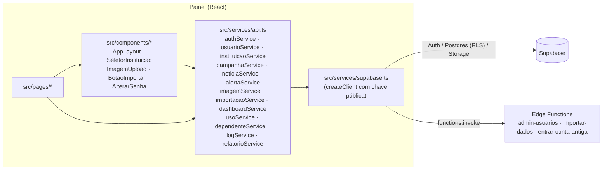
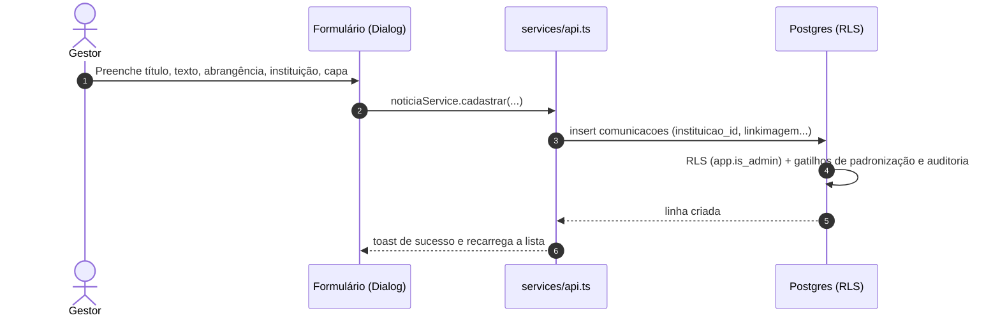

# 💻 Painel Administrativo (`Conecta-Vida-Admin`)

**Diretório:** `Conecta-Vida-Admin/conecta-a-vida-administrativo`
**Endereço:** https://conecta-vida-admin.netlify.app (deploy automático a cada push na `main`)
**Stack:** React 19 + TypeScript + Vite + Tailwind CSS + shadcn/ui (Radix) + Recharts + `@supabase/supabase-js` + jsPDF + Lucide

---

## 1. Arquitetura

O painel é uma SPA que fala **direto com o Supabase** — não há API intermediária. Toda chamada passa por `src/services/api.ts`, que expõe serviços por domínio e converte as linhas do banco (snake_case) para os tipos da tela (camelCase). Quem garante que só administradores escrevem é a RLS do banco; o painel só esconde o que não faz sentido mostrar.



### Estrutura de pastas

```text
conecta-a-vida-administrativo/
 ├── netlify.toml (na raiz do repositório)   # build e redirecionamento da SPA
 ├── src/
 │   ├── App.tsx                 # rotas públicas e protegidas (RotaProtegida = sessão válida)
 │   ├── pages/                  # uma tela por rota
 │   ├── components/             # layout, seletores e botões reutilizáveis
 │   │   └── ui/                 # componentes shadcn/ui (button, dialog, table...)
 │   └── services/
 │       ├── supabase.ts         # cliente Supabase (URL + chave pública)
 │       └── api.ts              # todos os serviços de dados
 └── supabase/ (na raiz do repositório)
     ├── migrations/             # SQL versionado do banco
     └── functions/              # Edge Functions (Deno)
```

---

## 2. Telas

| Rota | Tela | O que faz |
| :--- | :--- | :--- |
| `/login` | Login | E-mail e senha (só administradores), "Esqueci minha senha", botão Microsoft quando habilitado. Contas antigas da API Java migram no primeiro login. |
| `/` | Dashboard | Totais (usuários, alertas, campanhas, notícias), publicações por mês, atividade recente, campanhas mais procuradas, famílias no app. |
| `/usuarios` | Usuários | Busca, criar conta já confirmada, editar, **definir senha** de qualquer usuário, excluir, importar CSV, exportar CSV/PDF. |
| `/instituicoes` | Unidades de Saúde | Filtro por **cidade** (abre em Bragança Paulista), tipo e busca; selo **CNES** nas oficiais; importar do CNES; cadastrar/editar manualmente. |
| `/campanhas` e `/campanhas/:id` | Campanhas | Criar/editar com **instituição responsável**, público-alvo, período e capa; lista de inscritos (titulares e dependentes). |
| `/alertas` | Gestão de Alertas | Emitir alertas (chegam em tempo real no app), vinculados a uma instituição. |
| `/noticias` | Notícias | Capa, busca, filtro por abrangência, abas Ativas/Arquivadas, link da fonte, importar do Ministério da Saúde, **instituição responsável**. |
| `/dependentes` | Dependentes | Vínculos por situação (ativo, aguardando autorização, revogado) e como foram autorizados. |
| `/redefinir-senha`, `/email-confirmado` | Públicas | Destinos dos links de e-mail do Supabase (app e painel). |
| `/privacidade`, `/excluir-conta`, `/baixar` | Públicas | Política de privacidade (LGPD), exclusão de conta pela web e download do APK — exigências da Play Store. |

No menu lateral também ficam **Alterar minha senha** e **Sair do Sistema**.

---

## 3. Componentes de destaque

* **`SeletorInstituicao`** — campo "Instituição responsável" com busca, usado nos formulários de notícia, campanha e alerta. Lista órgãos e unidades cadastradas no painel primeiro, depois Bragança Paulista, depois as demais cidades. Grava `instituicao_id`; no app vira "Órgão publicador" com telefone e site.
* **`ImagemUpload`** — envia a capa para o bucket `comunicacoes` e devolve o endereço público.
* **`BotaoImportar`** — dispara a Edge Function `importar-dados` na hora (notícias ou unidades).
* **`AlterarSenha`** — troca a senha de quem está logado sem depender de e-mail.

---

## 4. Fluxo de criação de conteúdo



---

## 5. Requisitos do Painel

* **RF-FE01** Só administradores entram; a sessão é conferida no Supabase a cada abertura.
* **RF-FE02** Todo conteúdo pode ser vinculado a uma instituição cadastrada.
* **RF-FE03** Administrador pode criar contas, mudar permissões e definir senhas de outros usuários.
* **RF-FE04** Exportação de usuários em CSV/PDF e importação por CSV.
* **RNF-FE01** Responsivo: menu vira gaveta no celular e formulários empilham os campos em telas estreitas.
* **RNF-FE02** Nenhum segredo no navegador: só a chave pública; ações privilegiadas via Edge Functions.
