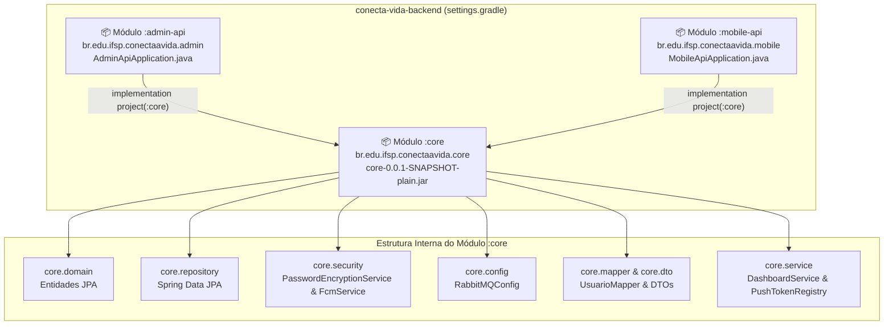
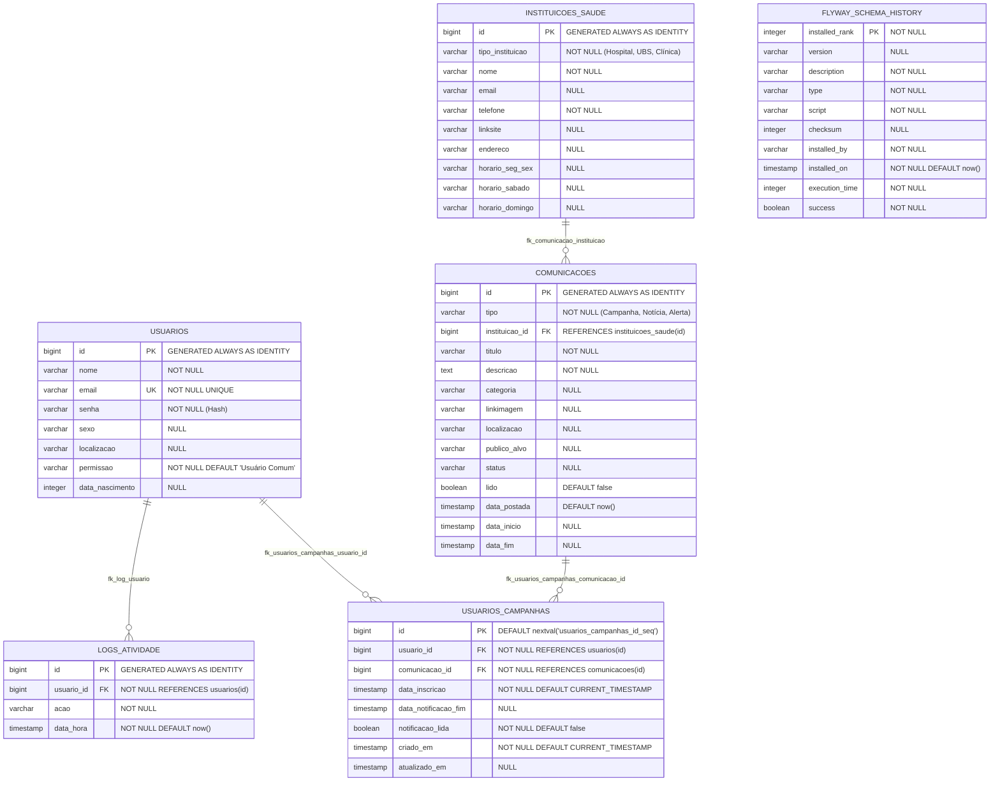
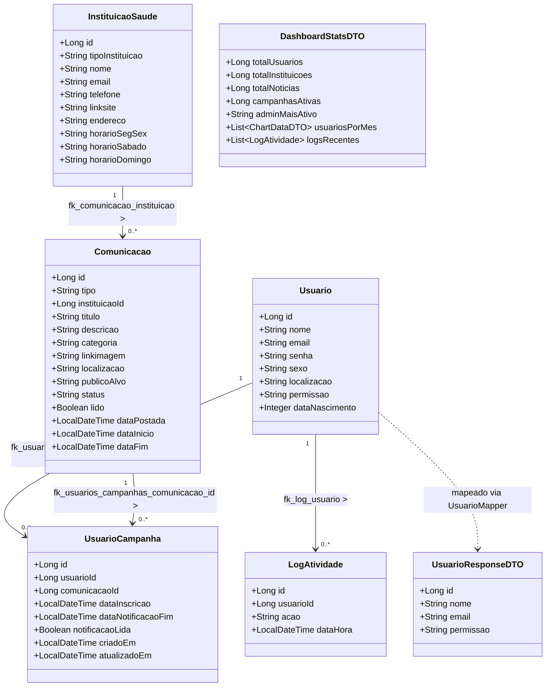
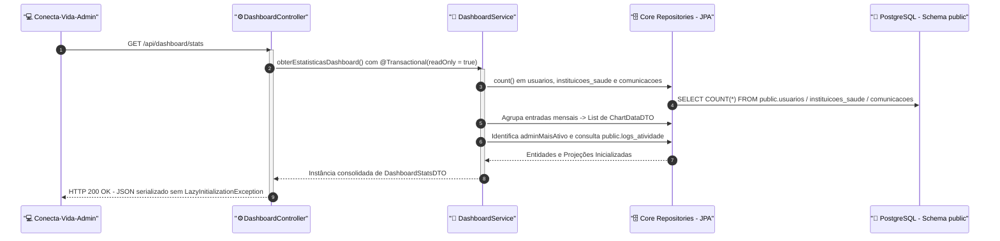
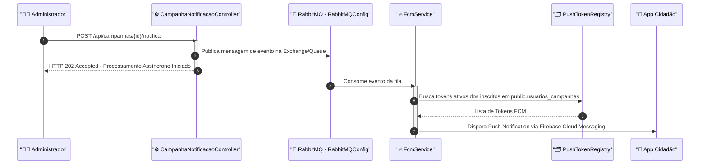

> ⚠️ **Documento histórico.** Esta é a especificação da API Java/Spring Boot usada até novembro de 2026. O projeto hoje usa o **Supabase** diretamente (veja [`README.md`](./README.md) e [`BANCO_E_SERVICOS.md`](./BANCO_E_SERVICOS.md)). O conteúdo abaixo é mantido para registro da evolução da arquitetura.

# ⚙️ Especificação Técnica da API, Backend e Banco de Dados (`conecta-vida-backend`)

**Pacote Raiz:** `br.edu.ifsp.conectaavida`  
**Gerenciador de Build:** Gradle `9.3.0` (Multi-Module)  
**Módulos:** `:core`, `:admin-api`, `:mobile-api`  
**Banco de Dados:** PostgreSQL (`schema: public`) gerenciado via **Flyway Migrations**

---

## 1. Arquitetura Interna e Grafo de Dependências entre Módulos

O backend adota os princípios de **Clean Architecture adaptada ao Spring Boot** e **Monólito Modular**. O módulo `:core` concentra o domínio, a persistência e a infraestrutura transversal (`core-0.0.1-SNAPSHOT-plain.jar`), sendo importado pelos módulos de exposição `:admin-api` e `:mobile-api`.

---

## 2. Arquitetura de Banco de Dados Relacional (PostgreSQL + Flyway)

O schema `public` do PostgreSQL utiliza versionamento evolutivo automatizado através do **Flyway** (`public.flyway_schema_history`), garantindo rastreabilidade de *checksum*, ordem de execução (`installed_rank`) e integridade referencial em todos os ambientes.

### 2.1. Diagrama Entidade-Relacionamento (DER — Fiel ao DDL)

### 2.2. Dicionário de Dados e Regras de Integridade

| Tabela (`schema: public`) | Entidade JPA (`core.domain`) | Chave Primária | Chaves Estrangeiras / Constraints | Papel Arquitetural |
| :--- | :--- | :--- | :--- | :--- |
| **`usuarios`** | `Usuario.java` | `usuarios_pkey (id)` | `email UNIQUE`; `permissao DEFAULT 'Usuário Comum'` | Armazena tanto cidadãos quanto administradores do sistema, incluindo localização, sexo e ano/data de nascimento. |
| **`instituicoes_saude`** | `InstituicaoSaude.java` | `instituicoes_saude_pkey (id)` | `tipo_instituicao NOT NULL`, `telefone NOT NULL` | Cadastro de Hospitais, UBS e Clínicas parceiras, incluindo endereço, site e grade de horários (`seg_sex`, `sabado`, `domingo`). |
| **`comunicacoes`** | `Comunicacao.java` | `comunicacoes_pkey (id)` | `fk_comunicacao_instituicao` $\rightarrow$ `instituicoes_saude(id)` | Tabela unificada (Single-Table Inheritance / Polimórfica por `tipo`) que armazena Campanhas, Notícias e Alertas com janela de vigência (`data_inicio`, `data_fim`). |
| **`usuarios_campanhas`** | `UsuarioCampanha.java` | `usuarios_campanhas_pkey (id)` | `fk_usuarios_campanhas_usuario_id` $\rightarrow$ `usuarios(id)` `fk_usuarios_campanhas_comunicacao_id` $\rightarrow$ `comunicacoes(id)` | Tabela associativa de inscrições de cidadãos em campanhas/comunicações, controlando ciclo de leitura de notificações (`notificacao_lida`, `data_notificacao_fim`). |
| **`logs_atividade`** | `LogAtividade.java` | `logs_atividade_pkey (id)` | `fk_log_usuario` $\rightarrow$ `usuarios(id)` | Trilha de auditoria imutável registrando quem executou a ação (`usuario_id`), a descrição (`acao`) e o carimbo de tempo (`data_hora`). |
| **`flyway_schema_history`** | *(Infraestrutura Flyway)* | `flyway_schema_history_pkey` | `installed_rank NOT NULL` | Auditoria e controle de versão das migrações SQL aplicadas automaticamente na subida da aplicação. |

---

## 3. Diagrama de Classes de Domínio e DTOs (`core.domain` & `core.dto`)

---

## 4. Especificação dos Módulos e Controladores REST

### 4.1. Módulo `:core` (`br.edu.ifsp.conectaavida.core`)
* **`core.repository` (Spring Data JPA)**:
  * `UsuarioRepository`: Acesso à tabela `public.usuarios`.
  * `InstituicaoSaudeRepository`: Acesso à tabela `public.instituicoes_saude`.
  * `ComunicacaoRepository`: Acesso à tabela `public.comunicacoes` (filtragem por `tipo`, `status`, `categoria` e `instituicao_id`).
  * `UsuarioCampanhaRepository`: Acesso à tabela `public.usuarios_campanhas`.
  * `LogAtividadeRepository`: Acesso à tabela `public.logs_atividade`.
* **`core.mapper` & `core.dto`**:
  * `UsuarioMapper` (`UsuarioMapperImpl` gerado via annotation processor): Converte `Usuario` em `UsuarioResponseDTO`, omitindo a coluna `senha`.
* **`core.security` & `core.config`**:
  * `PasswordEncryptionService`: Criptografia de senhas antes do `INSERT`/`UPDATE` em `public.usuarios`.
  * `FcmService` & `PushTokenRegistry`: Integração com Firebase Cloud Messaging para envio de notificações push.
  * `RabbitMQConfig`: Configuração de filas e exchanges AMQP.

### 4.2. Módulo `:admin-api` (`br.edu.ifsp.conectaavida.admin`)

| Controlador (`admin.controller`) | Serviço / Repositório Associado | Tabelas Afetadas (`public`) | Responsabilidade Técnica |
| :--- | :--- | :--- | :--- |
| **`AuthController`** | `UsuarioService`, `PasswordEncryptionService` | `usuarios`, `logs_atividade` | Autenticação de administradores e validação de credenciais. |
| **`DashboardController`** | `DashboardService`, `ChartDataDTO`, `DashboardStatsDTO` | Todas (Leitura agregada) | Endpoint `GET /api/dashboard/stats` consolidando KPIs, gráficos e logs recentes. |
| **`UsuarioController`** | `UsuarioService`, `UsuarioMapper` | `usuarios`, `logs_atividade` | CRUD completo (`/api/usuarios`), importação em lote e gestão de permissões. |
| **`InstituicaoSaudeController`** | `InstituicaoSaudeRepository` | `instituicoes_saude`, `logs_atividade` | CRUD de instituições parceiras (`/api/instituicoes`). |
| **`UnidadeSaudeController`** | `InstituicaoSaudeRepository` | `instituicoes_saude` | Gestão de unidades de saúde e horários de atendimento (`seg_sex`, `sabado`, `domingo`). |
| **`CampanhaController`** | `CampanhaService` | `comunicacoes`, `usuarios_campanhas` | Gestão de campanhas de saúde (`data_inicio`, `data_fim`, `publico_alvo`, `status`). |
| **`CampanhaNotificacaoController`** | `CampanhaService`, `FcmService` | `usuarios_campanhas`, `comunicacoes` | Disparo de alertas push para usuários vinculados em `usuarios_campanhas`. |
| **`ComunicacaoController`** | `ComunicacaoRepository` | `comunicacoes` | Gestão centralizada de registros na tabela `public.comunicacoes`. |
| **`NoticiaController`** | `ComunicacaoRepository` | `comunicacoes` | Publicação e edição de notícias informativas (`linkimagem`, `categoria`). |
| **`AlertaController`** | `ComunicacaoRepository` | `comunicacoes` | Emissão de alertas sanitários urgentes geolocalizados (`localizacao`). |
| **`RelatorioController`** | `RelatorioService` | `usuarios`, `comunicacoes`, `usuarios_campanhas` | Extração de relatórios gerenciais e estatísticas de adesão. |
| **`LogAtividadeController`** | `LogAtividadeRepository` | `logs_atividade` | Consulta ordenada do histórico de auditoria administrativa. |

### 4.3. Módulo `:mobile-api` (`br.edu.ifsp.conectaavida.mobile`)
* **`FeedController`** (`ComunicacaoService`): Consulta otimizada na tabela `public.comunicacoes` para exibir o feed no app móvel do cidadão.
* **`PushTokenController`** (`PushTokenRegistry`): Registra o token do dispositivo do cidadão para recebimento de alertas via FCM.

---

## 5. Diagramas de Sequência da API

### 5.1. Fluxo de Leitura Analítica (`DashboardController` -> `DashboardStatsDTO`)

### 5.2. Fluxo de Disparo de Notificação de Campanha (RabbitMQ + FCM)

---

## 6. Requisitos Funcionais e Não Funcionais da API

### 6.1. Requisitos Funcionais (RF-API)
* **RF-API-01 (Gestão de Usuários):** Permitir o cadastro, atualização, listagem e exclusão na tabela `public.usuarios`, atribuindo por padrão a permissão `'Usuário Comum'` quando não especificada e garantindo unicidade de `email`.
* **RF-API-02 (Gestão de Instituições e Horários):** Permitir o gerenciamento completo em `public.instituicoes_saude`, contemplando `tipo_instituicao`, dados de contato e horários de funcionamento (`horario_seg_sex`, `horario_sabado`, `horario_domingo`).
* **RF-API-03 (Polimorfismo de Comunicações):** Persistir Campanhas, Notícias e Alertas na tabela `public.comunicacoes`, vinculando opcionalmente à instituição autora via `fk_comunicacao_instituicao` e controlando o período de vigência (`data_inicio` e `data_fim`).
* **RF-API-04 (Controle de Inscrições e Leitura de Notificações):** Rastrear em `public.usuarios_campanhas` cada cidadão inscrito (`usuario_id`, `comunicacao_id`), permitindo auditar se a notificação foi lida (`notificacao_lida`) e quando expira (`data_notificacao_fim`).
* **RF-API-05 (Auditoria Obrigatória):** Registrar automaticamente em `public.logs_atividade` toda operação administrativa com chave estrangeira estrita (`fk_log_usuario`) para o autor da ação.

### 6.2. Requisitos Não Funcionais (RNF-API / ADRs)
* **RNF-API-01 — Versionamento Determinístico de Schema (Flyway):** Nenhuma alteração estrutural no PostgreSQL é feita manualmente em produção; todas as tabelas e constraints são versionadas e validadas por checksum na tabela `public.flyway_schema_history`.
* **RNF-API-02 — Prevenção de `LazyInitializationException` e Loops JSON:** Leituras utilizam `@Transactional(readOnly = true)` e projeção em DTOs (`DashboardStatsDTO`, `ChartDataDTO`, `UsuarioResponseDTO`), evitando erros HTTP 500 durante a serialização Jackson das chaves estrangeiras (`fk_comunicacao_instituicao`, `fk_log_usuario`, `fk_usuarios_campanhas_*`).
* **RNF-API-03 — Segurança de Credenciais e CORS:** Senhas são criptografadas via `PasswordEncryptionService` antes de atingir o banco, e o acesso cross-origin do painel administrativo é regido por `CorsConfig`.
