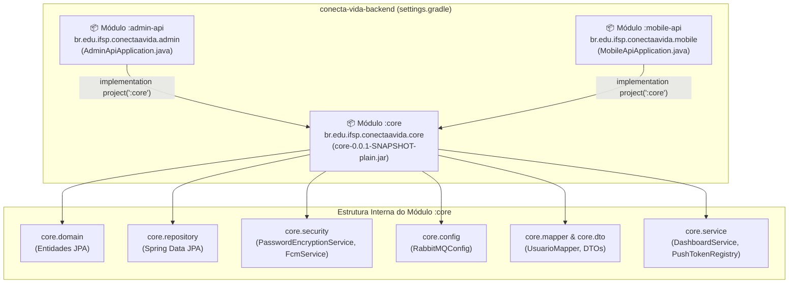
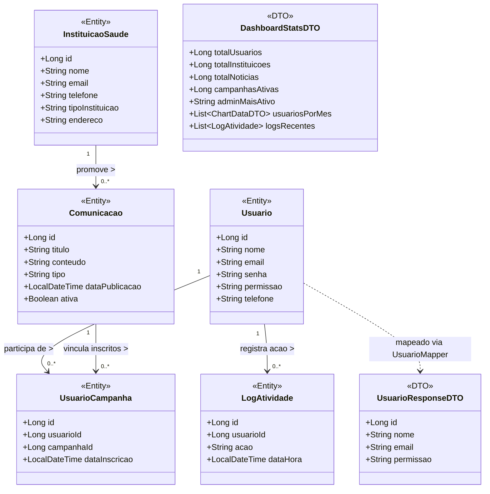
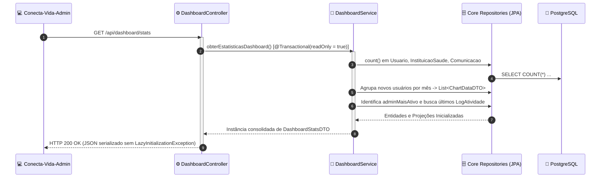

# ⚙️ Especificação Técnica da API e Backend (`conecta-vida-backend`)

**Pacote Raiz:** `br.edu.ifsp.conectaavida`[cite: 3]  
**Gerenciador de Build:** Gradle `9.3.0` (Multi-Module)[cite: 3]  
**Módulos:** `:core`, `:admin-api`, `:mobile-api`[cite: 3]

---

## 1. Arquitetura Interna e Grafo de Dependências entre Módulos

O backend foi projetado seguindo princípios de **Clean Architecture adaptada ao ecossistema Spring** e **Domain-Driven Design (DDD) tático**[cite: 3]. O módulo `:core` não possui dependência das camadas web externas; ao contrário, `:admin-api` e `:mobile-api` importam o artefato `core-0.0.1-SNAPSHOT-plain.jar` para reutilizar entidades, repositórios, serviços de domínio e configurações de infraestrutura[cite: 3].



---

## 2. Modelagem de Domínio e Diagrama de Classes JPA (`core.domain`)

Todas as entidades persistentes residem no pacote `br.edu.ifsp.conectaavida.core.domain` e são mapeadas no schema `public` do PostgreSQL:



---

## 3. Especificação Detalhada dos Pacotes por Módulo

### 3.1. Módulo `:core` (`br.edu.ifsp.conectaavida.core`)

* **`core.repository` (Camada de Persistência Spring Data JPA)**:


* `UsuarioRepository`: Operações CRUD, busca por e-mail/credenciais e agregações de usuários por período.


* `InstituicaoSaudeRepository`: Persistência e filtragem de instituições de saúde parceiras.


* `ComunicacaoRepository`: Repositório polimórfico/unificado para persistência de campanhas, notícias, comunicados e alertas.


* `UsuarioCampanhaRepository`: Gerenciamento de inscrições de cidadãos em campanhas de saúde.


* `LogAtividadeRepository`: Persistência e consulta ordenada das trilhas de auditoria do sistema.


* **`core.mapper` & `core.dto` (Camada de Transporte e Isolamento)**:


* `UsuarioMapper` e `UsuarioMapperImpl` (gerado via `annotationProcessor`): Realiza o mapeamento determinístico entre a entidade `Usuario` e `UsuarioResponseDTO`, garantindo que hashes de senha nunca vazem na camada JSON.


* `DashboardStatsDTO`: Objeto de transferência consolidado para alimentar os cartões e indicadores do painel.


* **`core.security` & `core.config` (Segurança, Mensageria e Push)**:


* `PasswordEncryptionService`: Criptografia unidirecional (hashing) de senhas de usuários e verificação segura durante o login.


* `FcmService` & `PushTokenRegistry`: Gerenciam o ciclo de vida dos tokens de dispositivos móveis e a comunicação com o **Firebase Cloud Messaging**.


* `RabbitMQConfig`: Declaração de filas, *exchanges* e roteamento AMQP para processamento assíncrono de notificações.


* **`core.service`**:


* `DashboardService`: Consolida métricas transversais de múltiplos repositórios para alimentar o dashboard administrativo.


---

### 3.2. Módulo `:admin-api` (`br.edu.ifsp.conectaavida.admin`)

Inicializado por `AdminApiApplication.java` e configurado por `CorsConfig.java` e `SwaggerConfig.java`. Possui **12 Controladores REST** especializados:

| Controlador (`admin.controller`) | Serviço / Dependência Principal | Rotas e Responsabilidades de Negócio |
| --- | --- | --- |
| **`AuthController`** | `UsuarioService`, `PasswordEncryptionService` | Autenticação administrativa (`/login` / `/api/auth`), validação de credenciais e emissão de sessão.

 |
| **`DashboardController`** | `DashboardService`, `ChartDataDTO`, `DashboardStatsDTO` | Endpoint `GET /api/dashboard/stats`. Retorna KPIs globais, série histórica de novos usuários por mês e logs recentes.

 |
| **`UsuarioController`** | `UsuarioService`, `UsuarioMapper` | Endpoints `/api/usuarios` (`GET`, `POST`, `PUT`, `DELETE`). Gerencia contas de cidadãos e administradores.

 |
| **`InstituicaoSaudeController`** | `InstituicaoSaudeRepository` | Endpoints `/api/instituicoes` (`GET`, `POST`, `PUT`, `DELETE`). CRUD de Hospitais, UBS e Clínicas.

 |
| **`UnidadeSaudeController`** | `InstituicaoSaudeRepository` | Gestão operacional de unidades de atendimento vinculadas.

 |
| **`CampanhaController`** | `CampanhaService` | CRUD completo de campanhas sanitárias e controle de vigência/status ativo.

 |
| **`CampanhaNotificacaoController`** | `CampanhaService`, `FcmService` | Acionamento de notificações direcionadas aos cidadãos inscritos em uma campanha.

 |
| **`ComunicacaoController`** | `ComunicacaoRepository` | Gestão unificada de publicações institucionais.

 |
| **`NoticiaController`** | `ComunicacaoRepository` | Publicação, atualização e remoção de notícias de saúde pública.

 |
| **`AlertaController`** | `ComunicacaoRepository` | Emissão rápida de alertas sanitários de urgência.

 |
| **`RelatorioController`** | `RelatorioService` | Geração e extração de relatórios gerenciais consolidados.

 |
| **`LogAtividadeController`** | `LogAtividadeRepository` | Consulta dedicada à trilha de auditoria administrativa.

 |

---

### 3.3. Módulo `:mobile-api` (`br.edu.ifsp.conectaavida.mobile`)

Inicializado por `MobileApiApplication.java` e documentado via `SwaggerConfig.java`:

* **`FeedController`** + **`ComunicacaoService`**: Fornece endpoints leves de leitura para que o aplicativo móvel liste campanhas abertas, notícias e alertas ativos sem expor regras administrativas.


* **`PushTokenController`** + **`PushTokenRegistry`**: Registra o token FCM do aparelho do cidadão para recebimento de alertas em tempo real.


---

## 4. Diagramas de Sequência da API

### 4.1. Fluxo de Leitura Analítica (`DashboardController` -> `DashboardStatsDTO`)



### 4.2. Fluxo de Disparo de Notificação de Campanha (RabbitMQ + FCM)

```mermaid
sequenceDiagram
    autonumber
    participant Admin as 👨‍💼 Administrador
    participantNCtrl as ⚙️ CampanhaNotificacaoController
    participant Broker as 🐇 RabbitMQ (RabbitMQConfig)
    participant FCM as 🔥 FcmService
    participant Reg as 🗂️ PushTokenRegistry
    participant Mobile as 📱 App Cidadão

    Admin->>NCtrl: POST /api/campanhas/{id}/notificar
    activate NCtrl
    NCtrl->>Broker: Publica mensagem de evento na Exchange/Queue
    NCtrl-->>Admin: HTTP 202 Accepted (Processamento Assíncrono Iniciado)
    deactivate NCtrl

    Broker->>FCM: Consome evento da fila
    activate FCM
    FCM->>Reg: Busca tokens ativos dos inscritos (UsuarioCampanha)
    Reg-->>FCM: Lista de Tokens FCM
    FCM->>Mobile: Dispara Push Notification via Firebase Cloud Messaging
    deactivate FCM
```

---

## 5. Casos de Uso Funcionais e Requisitos da API

### 5.1. Requisitos Funcionais da API (RF-API)

* **RF-API-01 (CRUD e Mapeamento de Usuários):** O `UsuarioController` e o `UsuarioService` devem permitir criar, listar, atualizar e remover usuários, criptografando a senha via `PasswordEncryptionService` e retornando dados via `UsuarioResponseDTO` (`UsuarioMapper`).


* **RF-API-02 (Consolidação Analítica do Dashboard):** O `DashboardController` deve retornar em uma única chamada os KPIs numéricos, os dados de gráficos (`ChartDataDTO`) e a lista de auditoria (`LogAtividade`).


* **RF-API-03 (Gestão de Instituições e Unidades de Saúde):** `InstituicaoSaudeController` e `UnidadeSaudeController` devem persistir e atualizar registros de Hospitais, UBS e Clínicas.


* **RF-API-04 (Ciclo Completo de Comunicação e Campanhas):** `CampanhaController`, `NoticiaController`, `AlertaController` e `ComunicacaoController` devem gerenciar todo o ciclo de vida das publicações e permitir notificações via `CampanhaNotificacaoController`.


* **RF-API-05 (Geração de Relatórios e Logs):** `RelatorioController` (`RelatorioService`) e `LogAtividadeController` devem prover dados consolidados para auditoria e tomada de decisão.


* **RF-API-06 (Entrega de Feed e Registro Mobile):** `FeedController` e `PushTokenController` no módulo `mobile-api` devem atender exclusivamente os aplicativos móveis.


### 5.2. Requisitos Não Funcionais da API (RNF-API / ADRs)

* **RNF-API-01 — Prevenção de `LazyInitializationException` e Loops JSON:** Todos os serviços de leitura utilizam escopo transacional `@Transactional(readOnly = true)` e desacoplamento por DTOs (`DashboardStatsDTO`, `ChartDataDTO`, `UsuarioResponseDTO`), eliminando erros `500 Internal Server Error` causados por proxies Hibernate fechados ou referências bidirecionais.


* **RNF-API-02 — Segurança de Credenciais:** Nenhuma senha é persistida em texto puro; o `PasswordEncryptionService` aplica hashing antes da persistência no PostgreSQL.


* **RNF-API-03 — Interoperabilidade CORS:** A classe `CorsConfig` habilita de forma controlada os métodos `GET`, `POST`, `PUT`, `DELETE` e `OPTIONS` para a origem do painel React.


* **RNF-API-04 — Documentação Viva (OpenAPI/Swagger):** Tanto `admin-api` quanto `mobile-api` possuem classes `SwaggerConfig` para inspeção e teste imediato dos contratos REST.


```

---
