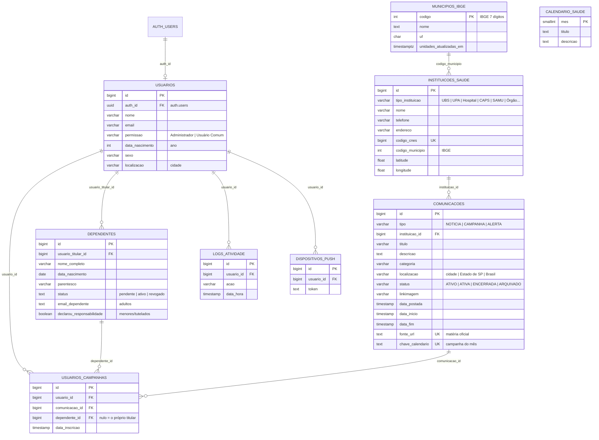

# 🗄️ Banco de Dados e Serviços (Supabase)

**Onde fica o código:** `Conecta-Vida-Admin/supabase/migrations` (SQL versionado) e `Conecta-Vida-Admin/supabase/functions` (Edge Functions).
**Regra de ouro:** toda tabela tem **RLS** ligada. O app e o painel usam só a chave pública; o que exige privilégio roda em Edge Function.

---

## 1. Diagrama Entidade-Relacionamento

*`flyway_schema_history` é herança da API Java e não é mais usada.*

---

## 2. Segurança (RLS e funções)

| Função (`schema app`) | Para que serve |
| :--- | :--- |
| `app.usuario_id()` | id em `usuarios` de quem está logado (a partir de `auth.uid()`). |
| `app.is_admin()` | se quem está logado é Administrador. Usada nas políticas de escrita de conteúdo. |
| `app.sincronizar_perfil()` | gatilho em `auth.users`: ao confirmar o e-mail, cria o perfil em `usuarios` ou liga a um perfil antigo com o mesmo e-mail (perfis de administrador só com verificação do servidor). |
| `app.aplicar_regras_dependente()` | titular ≥ 18 anos, no máximo 10 dependentes, menor/tutelado exige declaração, adulto fica "pendente" até autorizar. |
| `app.cancelar_inscricoes_do_revogado()` | ao revogar um dependente, cancela inscrições em campanhas abertas. |
| `app.padronizar_comunicacao()` | padroniza tipo/status em maiúsculas e limpa a localização. |
| `app.registrar_atividade()` | grava a trilha de auditoria em `logs_atividade`. |

**Políticas principais (`cv_*`):** leitura pública do conteúdo ativo; cidadão lê/edita só o próprio perfil, dependentes e inscrições; inscrição só para dependente `ativo` e campanha aberta; escrita em `comunicacoes`, `instituicoes_saude` e Storage só para administradores.

**RPCs chamadas pelos clientes:** `excluir_minha_conta()`, `meus_convites_de_dependente()`, `responder_convite_dependente(id, acao)`, `admin_definir_permissao(...)`, `admin_excluir_usuario(...)`.

---

## 3. Edge Functions

| Função | Quem chama | O que faz |
| :--- | :--- | :--- |
| `admin-usuarios` | Painel (administrador logado) | Cria conta já confirmada; `acao: "definir_senha"` define a senha de qualquer usuário (inclusive contas antigas). |
| `importar-dados` | Agendador (segredo do Vault) ou administrador | `noticias`: feeds do Ministério da Saúde e da Agência SP, com capa e abrangência; `imagens`: completa capas faltantes (ignora o logotipo genérico do gov.br); `unidades`: CNES de Bragança Paulista. |
| `unidades-proximas` | App (usuário logado) | Recebe `{cidade, uf}`, acha o município no IBGE, busca UBS/UPA/hospitais/CAPS/SAMU no CNES (cache de 30 dias) e devolve com coordenadas. |
| `entrar-conta-antiga` | App e painel, quando o login falha | Confere a senha de contas criadas pela API Java (hash antigo ou a própria API) e cria o login no Supabase com a mesma senha. |

---

## 4. Automações agendadas (`pg_cron`)

| Tarefa | Quando (Brasília) | Ação |
| :--- | :--- | :--- |
| `conecta-importar-noticias` | todo dia 6h10 e 18h10 | `app.chamar_importacao('noticias')` → Edge Function |
| `conecta-importar-unidades` | dia 1, 3h30 | `app.chamar_importacao('unidades')` |
| `conecta-calendario-saude` | dia 1, 6h15 | `app.publicar_campanha_do_mes()` (Novembro Azul, Dezembro Vermelho…) |
| `conecta-encerrar-campanhas` | todo dia 3h05 | `app.encerrar_campanhas_vencidas()` |
| `conecta-arquivar-noticias` | todo dia 3h20 | `app.arquivar_noticias_antigas()` (> 60 dias) |

Onde ver: painel do Supabase → **Integrations → Cron** (histórico de execuções) e **Edge Functions → importar-dados → Logs**.

---

## 5. Storage

| Bucket | Público | Conteúdo |
| :--- | :--- | :--- |
| `comunicacoes` | sim (até 5 MB, imagens) | Capas enviadas pelo painel e copiadas das matérias oficiais (`importadas/`). |
| `downloads` | sim (até 50 MB, APK) | `conecta-vida.apk` (arm64) e `conecta-vida-celular-antigo.apk` (armeabi-v7a), usados pela página `/baixar`. |

---

## 6. Configurações do projeto Supabase (fora do código)

* **Authentication → URL Configuration:** Site URL `https://conecta-vida-admin.netlify.app`; Redirect URLs `https://conecta-vida-admin.netlify.app/**`, `https://conecta-vida-app.netlify.app/**`, `br.edu.ifsp.conectavida://login-callback`.
* **SMTP próprio:** recomendado — o SMTP padrão só envia para membros do projeto e tem limite de 2 e-mails/hora.
* **Login Microsoft (opcional):** provedor Azure em Authentication → Providers; o botão aparece sozinho no app e no painel quando habilitado.
