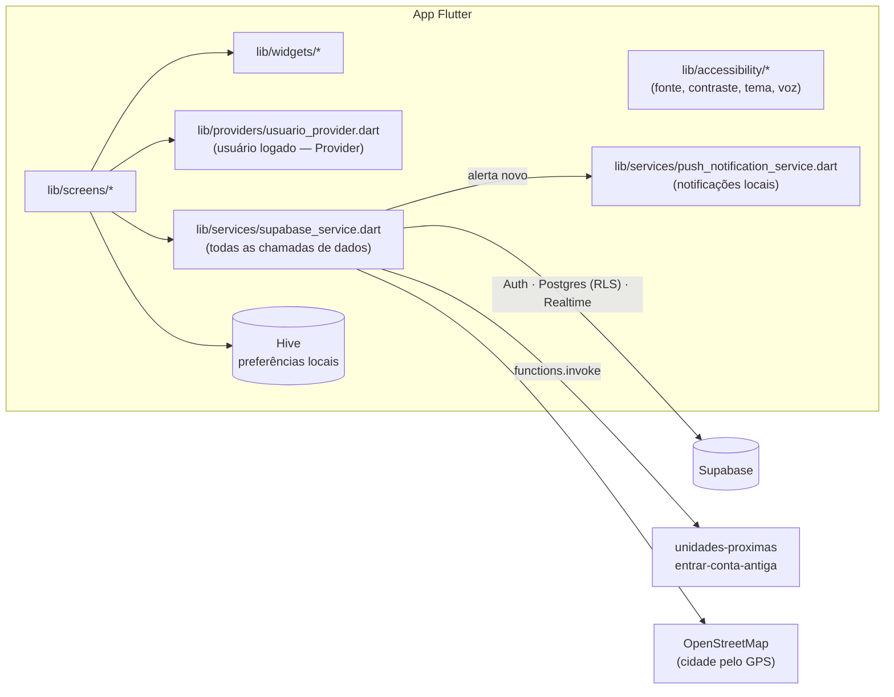

# 📱 Aplicativo do Cidadão (`Conecta-Vida-Mobile`)

**Tecnologia:** Flutter 3.44 / Dart 3.12 — Android, iOS e Web (PWA)
**Identificador:** `br.edu.ifsp.conectavida` · versão em `pubspec.yaml`
**Web:** https://conecta-vida-app.netlify.app · **APK:** https://conecta-vida-admin.netlify.app/baixar

---

## 1. Arquitetura



```text
lib/
 ├── main.dart                 # inicialização, tema (azul da marca), acessibilidade,
 │                             # moldura de celular no computador e área segura do Android 15+
 ├── screens/                  # login, cadastro, confirmar e-mail, notícias (início), detalhes,
 │                             # cronograma, notificações, unidades de saúde, ajustes,
 │                             # dependentes, autorizações, acessibilidade
 ├── widgets/                  # barra inferior, cartões de notícia, recomendados...
 ├── models/                   # usuário, notícia, dependente, unidade de saúde
 ├── services/                 # supabase_service.dart, push_notification_service.dart
 ├── providers/ · accessibility/ · global/ (cores, textos, config)
test/                          # testes de unidade (modelos e regras)
```

---

## 2. Funcionalidades

| Tela | Destaques |
| :--- | :--- |
| Login / Cadastro | Confirmação de e-mail obrigatória, mostrar senha, "Esqueci senha", login Microsoft (quando habilitado). Cadastro só para maiores de 18 anos. Contas antigas migram no primeiro login. |
| Início (notícias) | Abas Notícias / Vacinas / Doações / Alertas / Campanhas; busca; filtro por cidade, "Brasil" e "Estado de SP"; **Recomendados para você**; pop-up do alerta novo da cidade. |
| Detalhes | Capa, texto, abrangência (link do mapa só para cidades), órgão publicador com telefone/site, link da matéria original, inscrição na campanha (titular e dependentes), compartilhar, ouvir o texto. |
| Unidades de saúde | Cidade pelo GPS (ou perfil), qualquer município do Brasil (CNES), ordenadas pela distância, filtros por tipo e 24 h, ligar e "Como chegar"; botão **Trocar** cidade. |
| Cronograma | Campanhas em que a pessoa (ou dependente) está inscrita. |
| Automático | Com o GPS ligado, a cidade do perfil acompanha onde a pessoa está (1×/dia) — filtro, recomendados, alertas e unidades se ajustam sozinhos. Alertas novos chegam em tempo real; lembrete na tela de Notificações um dia antes da campanha. |
| Ajustes | Perfil, regiões de interesse, GPS, notificações, acessibilidade, dependentes, autorizações (só quando há pedido), **Painel administrativo** (só para administradores), política de privacidade, sair e excluir conta. |

### Como os "Recomendados" são escolhidos
Entram só campanhas e alertas ainda abertos em que a pessoa não está inscrita. Pontos: +3 se for na cidade dela, +2 se for da mesma categoria de campanhas em que já se inscreveu, +1 por ser campanha (alertas só se forem da cidade). Mostra os 6 com mais pontos; empate → mais recente.

---

## 3. Publicação

* **Web (PWA):** Netlify compila com o Flutter a cada push na `main` (`netlify.toml`). No celular dá para usar "Adicionar à tela de início".
* **APK direto:** `flutter build apk --release --split-per-abi`; os arquivos ficam no bucket `downloads` e a página `/baixar` aponta para eles.
* **Play Store:** guia completo em `PUBLICAR_NA_PLAY_STORE.md` (assinatura via `android/key.properties`, ícone e imagem de destaque em `loja/`, formulário de segurança de dados, textos da loja).

---

## 4. Requisitos do App

* **RF-APP01** Conteúdo filtrado pela cidade do usuário e pelas abrangências escolhidas.
* **RF-APP02** Inscrição em campanhas para o titular e dependentes ativos.
* **RF-APP03** Unidades do SUS de qualquer cidade, com distância e rota.
* **RF-APP04** Exclusão da conta pelo app (Ajustes → Deletar) e pela web.
* **RNF-APP01** Acessibilidade: escala de fonte, negrito, alto contraste, modo escuro, menos movimento, leitura em voz alta.
* **RNF-APP02** Funciona sem Firebase: alertas por Realtime + notificação local.
* **RNF-APP03** Layout respeita a barra de navegação do Android (edge-to-edge) e aparece com largura de celular no computador.
