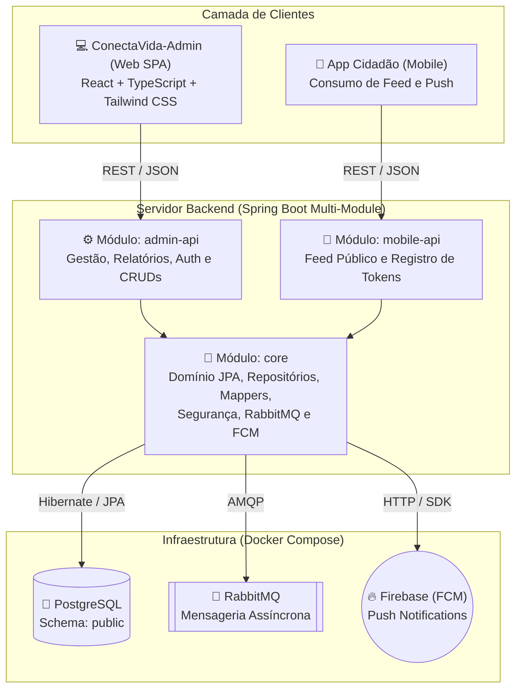
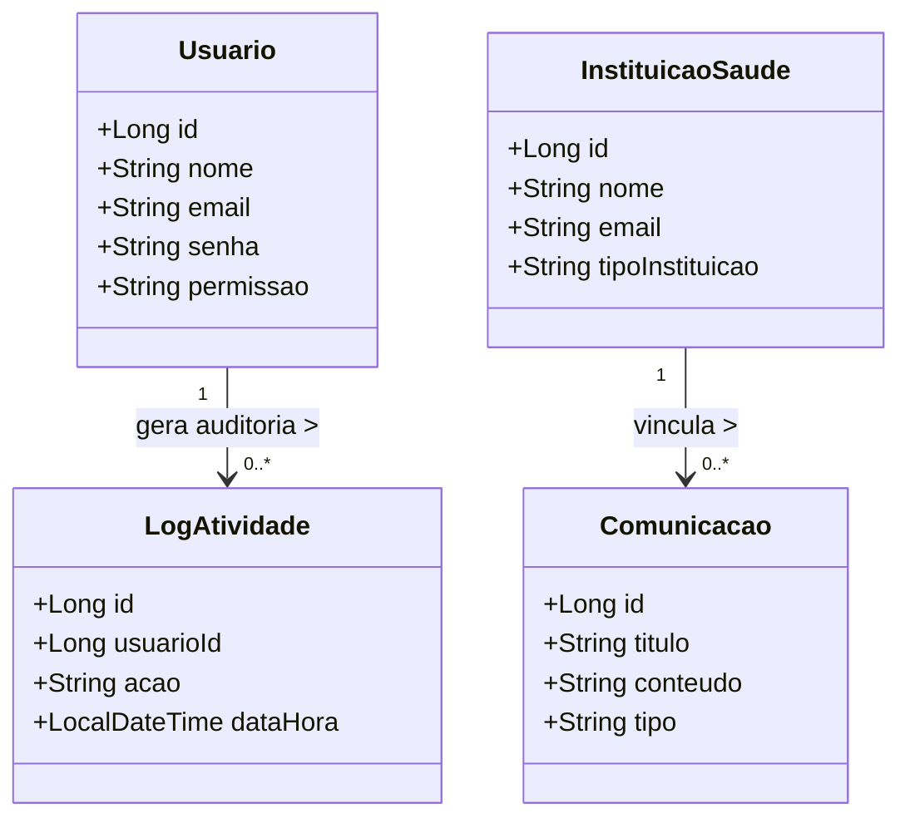
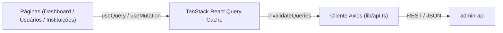

# 🌟 Documentação Oficial - Projeto ConectaVida

Bem-vindo ao repositório central de documentação técnica do ecossistema **ConectaVida**. Este espaço consolida os guias arquiteturais, especificações de backend e manuais do painel administrativo para alinhar toda a equipe de desenvolvimento.

## 📚 Índice de Documentos
* [📖 1. Visão Geral e Arquitetura Macro](#1-visão-geral-do-sistema)
* [⚙️ 2. Especificação Técnica da API (Backend)](API_BACKEND.md)
* [💻 3. Manual do Painel Administrador (Frontend)](ADMIN_FRONTEND.md)

---

## 1. Visão Geral do Sistema
O **ConectaVida** é uma plataforma distribuída voltada à gestão de saúde pública, campanhas sanitárias e comunicação com o cidadão. 

### Arquitetura Macro (Containers)



#### B. Arquivo `API_BACKEND.md` (Focado só na API / Backend)
Crie um novo arquivo chamado `API_BACKEND.md` e cole o conteúdo técnico do backend:


# ⚙️ Especificação Técnica da API e Backend (`conecta-vida-backend`)

Este documento detalha a arquitetura do servidor, organizada sob o padrão de monólito modular com Gradle multi-módulos.

## 1. Estrutura dos Módulos
* **`core`**: Contém o domínio JPA (`Usuario`, `InstituicaoSaude`, `Comunicacao`, `UsuarioCampanha`, `LogAtividade`), repositórios Spring Data, serviços de criptografia (`PasswordEncryptionService`), mensageria RabbitMQ e integração FCM (`FcmService` / `PushTokenRegistry`).
* **`admin-api`**: Controladores REST exclusivos para o painel de gestão administrativa (`DashboardController`, `UsuarioController`, `InstituicaoSaudeController`, `CampanhaController`, etc.), configurados com CORS e Swagger.
* **`mobile-api`**: Controladores leves (`FeedController`, `PushTokenController`) voltados ao consumo dos aplicativos móveis dos cidadãos.

## 2. Diagrama de Domínio (Classes JPA)


## 3. Decisões Técnicas Principais (RNFs)

* **Prevenção de LazyInitializationException:** Leituras isoladas utilizam `@Transactional(readOnly = true)` e conversão segura para DTOs (`UsuarioResponseDTO`, `DashboardStatsDTO`) através de mappers dedicados.
* **Auditoria Automática:** Mutação de dados críticos gera registros imutáveis na tabela `log_atividade`.

---

#### C. Arquivo `ADMIN_FRONTEND.md` (Focado só no Administrador / Frontend)
Crie um novo arquivo chamado `ADMIN_FRONTEND.md` e cole o conteúdo focado na interface web:


# 💻 Manual Técnico do Painel Administrador (`conecta-vida-admin`)

Documentação focada na Single Page Application (SPA) construída em React, TypeScript, Tailwind CSS, TanStack React Query e Recharts.

## 1. Hierarquia da Interface e Layout (`AdminLayout.tsx`)
* **Ordem de Navegação Rigorosa:** 
  1. **Dashboard** (`/`)
  2. **Usuários** (`/usuarios`)
  3. **Campanhas** (`/campanhas`)
  4. **Instituições** (`/instituicoes`)
* **Fixação da Sidebar:** A barra lateral utiliza altura fixa (`h-screen`) no desktop para garantir que o botão de **Sair do Sistema** permaneça acessível sem necessidade de rolar páginas extensas com milhares de registros. Em dispositivos móveis, transforma-se em um menu lateral deslizante (*drawer*).

## 2. Fluxo de Estado com React Query


## 3. Módulos Principais

* **Dashboard:** Consolida KPIs, gráficos de linha e barras (Recharts) e exibe um feed dinâmico de **Logs de Atividade Ao Vivo** com quebras de linha controladas (`break-all whitespace-normal`).
* **Usuários & Instituições:** Tabelas compactas (`py-2.5 px-4`, `text-xs`) com modais CRUD integrados, além de suporte nativo a **importação/exportação em lote via CSV** e geração de relatórios em **PDF** (`window.print()`).


---

### Por que essa estrutura em um repositório separado é excelente?
1. **Leitura Nativa no GitHub:** O próprio GitHub vai renderizar os títulos, tabelas, formatações e **todos os diagramas Mermaid instantaneamente** na tela sem precisar de ferramentas externas.
2. **Organização Limpa:** Qualquer desenvolvedor que entrar em `conecta-vida-docs` encontrará de forma imediata o sumário no `README.md` e poderá navegar diretamente para a API ou para o Frontend.

```
