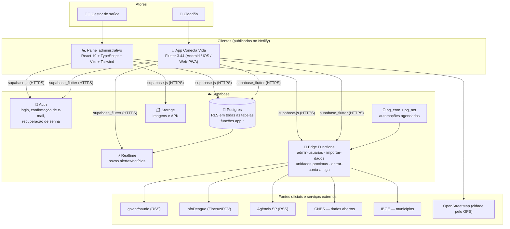
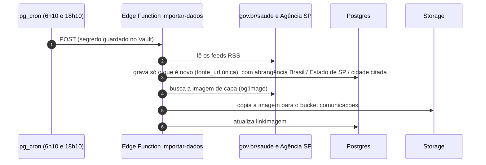
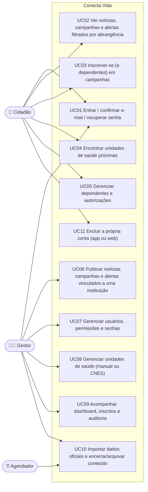

# 🏥 Conecta Vida — Documento de Arquitetura de Software (SAD)

**Instituição:** IFSP — Câmpus Bragança Paulista · Tecnologia em Análise e Desenvolvimento de Sistemas
**Identificador do app:** `br.edu.ifsp.conectavida`
**Arquitetura atual:** App Flutter + Painel React → **Supabase** (Auth, Postgres com RLS, Realtime, Storage, Edge Functions, pg_cron), publicados no **Netlify**
**Padrão de documentação:** Docs-as-Code (C4 Model / UML / ADR)

> **Mudança de arquitetura (novembro/2026):** a API Java/Spring Boot com RabbitMQ e Firebase deu lugar ao Supabase acessado diretamente pelo app e pelo painel. A especificação antiga continua em [`API_BACKEND.md`](./API_BACKEND.md) como **registro histórico**; o motivo da troca está na [ADR-01](#8-decisões-de-arquitetura-adr).

---

## 📚 Portal de Navegação

| Documento | Conteúdo |
| :--- | :--- |
| 📖 **README.md** (este) | Visão geral, arquitetura C4, tecnologias, fluxos, casos de uso, requisitos, decisões (ADR) e como rodar/publicar. |
| 🗄️ [`BANCO_E_SERVICOS.md`](./BANCO_E_SERVICOS.md) | Banco Postgres (DER), regras de acesso (RLS), funções, Edge Functions, automações agendadas e Storage. |
| 💻 [`ADMIN_FRONTEND.md`](./ADMIN_FRONTEND.md) | Painel administrativo web (React + TypeScript + Vite). |
| 📱 [`MOBILE_APP.md`](./MOBILE_APP.md) | Aplicativo do cidadão (Flutter: Android, iOS e Web/PWA). |
| 🗃️ [`API_BACKEND.md`](./API_BACKEND.md) | *(Legado)* API Java/Spring Boot usada até nov/2026. |

**Endereços em produção**

| O quê | Endereço |
| :--- | :--- |
| App (web / PWA) | https://conecta-vida-app.netlify.app |
| Painel administrativo | https://conecta-vida-admin.netlify.app |
| Baixar o app Android (APK) | https://conecta-vida-admin.netlify.app/baixar |
| Política de privacidade | https://conecta-vida-admin.netlify.app/privacidade |
| Excluir conta (web) | https://conecta-vida-admin.netlify.app/excluir-conta |

**Repositórios:** [`Conecta-Vida-Mobile`](https://github.com/Conecta-Vida/Conecta-Vida-Mobile) (app) · [`Conecta-Vida-Admin`](https://github.com/Conecta-Vida/Conecta-Vida-Admin) (painel + migrations + Edge Functions) · `Conecta-Vida-Documentacao` (este).

---

## 1. Visão Executiva e Propósito

O **Conecta Vida** reúne em um só lugar as informações de saúde pública que importam ao cidadão, **sempre de fontes oficiais**, combatendo a desinformação:

* **Notícias** do Ministério da Saúde e do Governo do Estado de SP, importadas automaticamente, com imagem e link da matéria original.
* **Campanhas** (vacinação, doação de sangue, Novembro Azul…) com inscrição pelo app — para o titular e seus dependentes.
* **Alertas** de saúde que chegam em tempo real — inclusive automáticos de dengue, chikungunya e zika quando o InfoDengue (Fiocruz/FGV) aponta nível laranja ou vermelho na cidade.
* **Unidades de saúde do SUS** de qualquer cidade do Brasil (dados oficiais do CNES), ordenadas pela distância do usuário.
* **Acessibilidade:** tamanho de texto, alto contraste, modo escuro, redução de movimento e leitura em voz alta.

Os **gestores de saúde** usam o painel web para publicar conteúdo vinculado a uma instituição cadastrada, acompanhar inscritos e métricas de uso e administrar contas.

---

## 2. Arquitetura Macro (C4 — Visão de Containers)



**Princípio central:** não existe servidor próprio. Quem protege os dados são as **regras de acesso (RLS) do Postgres** — o app e o painel usam apenas a chave pública; operações privilegiadas (criar conta confirmada, trocar senha de outro usuário, importar dados) ficam em **Edge Functions** que conferem se quem chamou é administrador.

---

## 3. Matriz Tecnológica

| Camada | Tecnologia | Papel |
| :--- | :--- | :--- |
| App do cidadão | Flutter 3.44 / Dart 3.12, `supabase_flutter`, Provider, Hive, Geolocator, url_launcher, flutter_tts, flutter_local_notifications | Interface Android/iOS/Web, cache local de preferências, GPS, leitura em voz alta e notificações locais. |
| Painel | React 19, TypeScript, Vite, Tailwind CSS, shadcn/ui (Radix), Recharts, `@supabase/supabase-js`, jsPDF | Gestão de conteúdo, usuários e unidades; gráficos; exportação CSV/PDF. |
| Autenticação | Supabase Auth | Cadastro com confirmação de e-mail, login, recuperação de senha, login Microsoft (opcional). |
| Banco | Postgres 17 (Supabase) | Dados, RLS, gatilhos e funções de regra de negócio (`schema app`). |
| Tempo real | Supabase Realtime | Alertas novos aparecem no app sem recarregar. |
| Arquivos | Supabase Storage | Bucket `comunicacoes` (imagens) e `downloads` (APK). |
| Lógica no servidor | Supabase Edge Functions (Deno/TypeScript) | Operações de administrador e importação de dados oficiais. |
| Automação | `pg_cron` + `pg_net` + Vault | Importação diária de notícias, mensal de unidades, encerramento de campanhas e arquivamento. |
| Hospedagem | Netlify | Deploy automático do app web e do painel a cada push na `main`. |

---

## 4. Fluxos Ponta a Ponta

### 4.1. Gestor publica um alerta → cidadão é avisado na hora

```mermaid
sequenceDiagram
    autonumber
    actor G as Gestor
    participant P as Painel (React)
    participant DB as Postgres (RLS)
    participant RT as Realtime
    participant A as App (Flutter)
    actor C as Cidadão

    G->>P: Emite alerta (escolhe a instituição responsável)
    P->>DB: INSERT comunicacoes (tipo ALERTA)
    DB->>DB: RLS confere app.is_admin(); gatilhos padronizam e registram em logs_atividade
    DB-->>RT: evento de nova linha
    RT-->>A: alerta novo (tempo real)
    A->>C: pop-up + notificação local (se for da cidade dele ou geral)
```

### 4.2. Importação automática de notícias oficiais



### 4.3. Unidades de saúde de qualquer cidade

O app descobre a cidade/UF pelo GPS (OpenStreetMap) ou pelo perfil e chama a Edge Function `unidades-proximas`, que encontra o município no IBGE, consulta o CNES (UBS, UPA, hospitais, CAPS, SAMU) se a cidade ainda não foi buscada nos últimos 30 dias, grava no banco e devolve a lista com coordenadas. O app ordena pela distância.

---

## 5. Casos de Uso Globais



---

## 6. Requisitos Globais

### 6.1. Requisitos Funcionais (RF)
* **RF01 — Contas:** cadastro com confirmação de e-mail, login, recuperação de senha e exclusão de conta (no app e na web). Contas só para maiores de 18 anos; menores entram como dependentes.
* **RF02 — Conteúdo oficial:** notícias, campanhas e alertas ficam em `comunicacoes`, vinculados a uma instituição (`instituicoes_saude`) escolhida pelo gestor.
* **RF03 — Abrangência:** cada conteúdo tem abrangência (cidade, "Estado de SP" ou "Brasil"); o app filtra pela cidade do usuário e pelas regiões escolhidas.
* **RF04 — Inscrições:** titular e dependentes ativos podem se inscrever em campanhas abertas; o gestor vê a lista de inscritos.
* **RF05 — Dependentes:** menores/tutelados entram com declaração do responsável; adultos precisam autorizar o vínculo; limite de 10 por titular.
* **RF06 — Unidades de saúde:** lista oficial (CNES) de qualquer cidade do Brasil, com distância, telefone e rota.
* **RF07 — Automação:** importação de notícias (2×/dia) e unidades (mensal), **alertas de dengue/chikungunya/zika pelo InfoDengue (diário)**, campanha do mês do calendário de saúde, encerramento de campanhas vencidas, arquivamento de notícias (> 60 dias) e alertas (> 30 dias) e **cidade do usuário atualizada pelo GPS** no app.
* **RF08 — Administração:** criar contas confirmadas, definir permissão, **definir a senha de outro usuário**, exportar CSV/PDF, auditoria em `logs_atividade`.

### 6.2. Requisitos Não Funcionais (RNF)
* **RNF01 — Segurança por RLS:** toda tabela tem RLS; o cidadão só lê/escreve os próprios dados; escrita de conteúdo só para administradores (`app.is_admin()`).
* **RNF02 — Segredos fora do cliente:** a chave de serviço do Supabase só existe nas Edge Functions; o agendador usa um segredo guardado no Vault.
* **RNF03 — LGPD:** dados mínimos, opcionais marcados, política de privacidade pública, exclusão de conta pela web e pelo app.
* **RNF04 — Acessibilidade:** fonte ajustável, alto contraste, modo escuro, leitura em voz alta, alvos de toque ≥ 48 px.
* **RNF05 — Responsividade:** painel utilizável no celular (formulários empilham campos em telas estreitas); app centralizado com largura de celular no computador; rodapé respeita a barra de navegação do Android 15+.
* **RNF06 — Entrega contínua:** push na `main` publica automaticamente no Netlify; mudanças de banco versionadas em `supabase/migrations`.

---

## 7. Como rodar e publicar

### 7.1. App (Flutter)
```bash
git clone https://github.com/Conecta-Vida/Conecta-Vida-Mobile.git
cd Conecta-Vida-Mobile
flutter pub get
flutter run -d chrome          # ou um celular/emulador Android
flutter test                   # testes de unidade
```
APK para instalar direto: `flutter build apk --release --split-per-abi`. Publicação na Play Store: ver `PUBLICAR_NA_PLAY_STORE.md` no repositório do app.

### 7.2. Painel (React)
```bash
git clone https://github.com/Conecta-Vida/Conecta-Vida-Admin.git
cd Conecta-Vida-Admin/conecta-a-vida-administrativo
npm install
npm run dev                    # http://localhost:5173
```

### 7.3. Banco e Edge Functions
As mudanças de banco ficam em `Conecta-Vida-Admin/supabase/migrations` e as funções em `Conecta-Vida-Admin/supabase/functions`. São aplicadas no projeto Supabase (painel do Supabase → SQL Editor / Edge Functions, ou Supabase CLI). Detalhes em [`BANCO_E_SERVICOS.md`](./BANCO_E_SERVICOS.md).

### 7.4. Publicação
O Netlify publica sozinho a cada push na `main`: `Conecta-Vida-Admin` → painel, `Conecta-Vida-Mobile` → app web (o `netlify.toml` de cada repositório tem o comando de build).

---

## 8. Decisões de Arquitetura (ADR)

| # | Decisão | Motivo | Consequência |
| :--- | :--- | :--- | :--- |
| ADR-01 | Trocar a API Java (Spring Boot + RabbitMQ + Firebase) pelo **Supabase acessado diretamente** | Servidor Java exigia hospedagem paga/instável, e parte da stack existia só para atender requisitos de disciplinas; a equipe perdeu acesso ao Firebase. | Menos peças para manter; segurança passa a depender de RLS bem escrita (coberta por migrations versionadas). |
| ADR-02 | **RLS + funções `security definer`** em vez de endpoints | Cada regra fica no banco, valendo igual para app e painel. | Regras de dependentes e inscrições aplicadas por gatilhos; impossível burlar pelo cliente. |
| ADR-03 | **Edge Functions** para o que exige privilégio | A chave de serviço nunca pode ir para o navegador/celular. | `admin-usuarios`, `importar-dados`, `unidades-proximas`, `entrar-conta-antiga`. |
| ADR-04 | **Dados oficiais importados automaticamente** (gov.br, Agência SP, CNES, IBGE) | Conteúdo real e atualizado sem trabalho manual. | `pg_cron` + Vault; nada é apagado, só entram registros novos. |
| ADR-05 | **Contas antigas migradas no primeiro login** | Usuários da API Java tinham só hash de senha na tabela. | `entrar-conta-antiga` confere a senha antiga e cria o login no Supabase com a mesma senha. |
| ADR-06 | **Realtime + notificação local** em vez de push (FCM) | Sem Firebase; alertas chegam enquanto o app está aberto. | Push com o app fechado fica como melhoria futura. |

---

## 9. Equipe

Luiz Henrique Gonçalves · Gustavo Barros Tenório · Gabriel Dias Ribeiro · Maycon Cabral da Silva · Pedro do Prado Hardmann — IFSP Câmpus Bragança Paulista.
