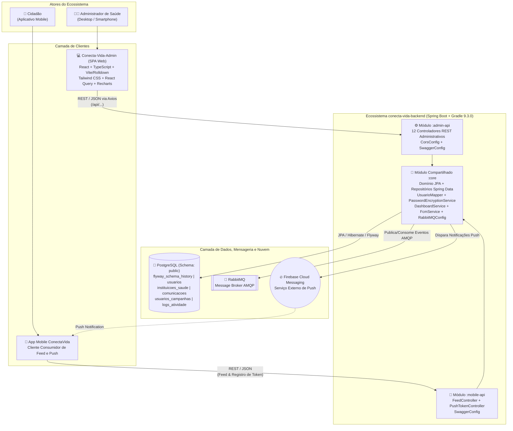
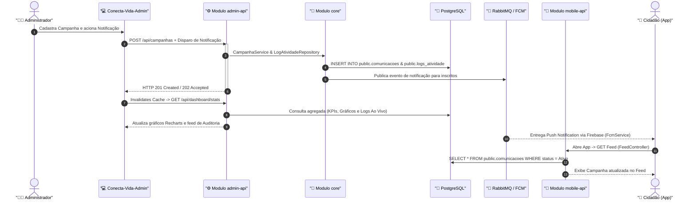
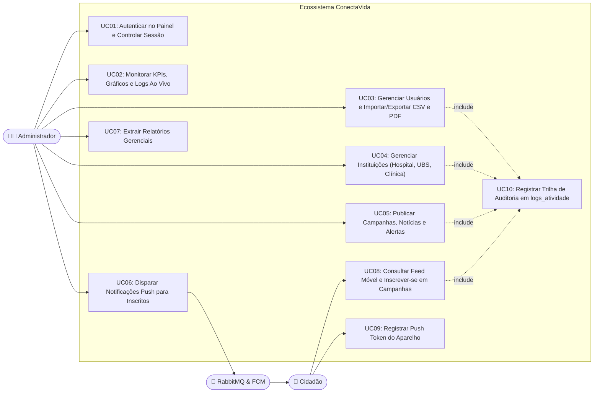

# 🏥 Ecossistema ConectaVida — Documento de Arquitetura de Software (SAD)

**Domínio Base:** `br.edu.ifsp.conectaavida`[cite: 1, 3]  
**Repositórios Integrados:** `conecta-vida-backend` (Multi-Module Spring Boot) & `Conecta-Vida-Admin` (React + TypeScript SPA)[cite: 1, 2, 3]  
**Banco de Dados:** PostgreSQL (`schema: public`) com versionamento **Flyway**[cite: 1, 3]  
**Padrão de Documentação:** Docs-as-Code (C4 Model / UML / ADR)

---

## 📚 Portal de Navegação da Documentação

Este repositório centraliza a especificação de engenharia de software do projeto **ConectaVida**, dividida em três documentos técnicos:

1. 📖 **[Visão Geral e Arquitetura Macro (`README.md` - Este Documento)](#1-visão-executiva-e-propósito-do-ecossistema)** — Contexto de negócio, topologia C4, matriz tecnológica, fluxos ponta a ponta, casos de uso macro, requisitos globais e guia de execução.
2. ⚙️ **[Especificação Técnica da API, Backend e Banco de Dados (`API_BACKEND.md`)](./API_BACKEND.md)** — Detalhamento dos módulos Gradle (`:core`, `:admin-api`, `:mobile-api`), Diagrama Entidade-Relacionamento (DER) do PostgreSQL, controladores REST, mensageria RabbitMQ e Firebase (FCM)[cite: 1, 3].
3. 💻 **[Especificação Técnica do Painel Administrador (`ADMIN_FRONTEND.md`)](./ADMIN_FRONTEND.md)** — Arquitetura da Single Page Application (SPA), árvore de componentes React, ciclo de cache com TanStack React Query, gráficos Recharts, tabelas compactas e fluxos de importação/exportação (CSV/PDF)[cite: 2].

---

## 1. Visão Executiva e Propósito do Ecossistema

O **ConectaVida** é uma plataforma distribuída de gestão em saúde pública e comunicação cidadã[cite: 1, 2, 3]. O sistema resolve a fragmentação de informações sanitárias ao conectar gestores públicos, instituições de saúde (**Hospitais**, **UBS** e **Clínicas**) e cidadãos em uma infraestrutura única[cite: 1, 3].

Através do ecossistema, administradores gerenciam campanhas sanitárias (com controle de vigência e público-alvo), publicam notícias e alertas emergenciais, credenciam unidades de atendimento com grades de horário e auditam todas as operações em tempo real[cite: 1, 3]. Na outra ponta, os cidadãos consomem um feed otimizado no aplicativo móvel, inscrevem-se em campanhas e recebem notificações *push* assíncronas[cite: 1, 3].

### 1.1. Padrões Arquiteturais Adotados
* **Monólito Modular com BFF (*Backend for Frontend*):** O servidor Java/Spring Boot é segmentado via Gradle em três módulos (`:core`, `:admin-api` e `:mobile-api`)[cite: 1, 3]. As regras de negócio, entidades JPA e integrações residem no `:core`, enquanto `:admin-api` e `:mobile-api` expõem contratos REST isolados e específicos para cada tipo de cliente[cite: 1, 3].
* **Arquitetura Orientada a Eventos para Notificações:** Disparos de alertas e avisos de campanhas utilizam **RabbitMQ** (`RabbitMQConfig`) aliado ao **Firebase Cloud Messaging** (`FcmService` e `PushTokenRegistry`), desacoplando o tempo de resposta HTTP do envio em massa para os dispositivos móveis[cite: 1, 3].
* **SPA Reativa Orientada a Server-State:** O painel administrativo (`Conecta-Vida-Admin`) utiliza **React**, **TypeScript** e **TanStack React Query** para manter a interface sincronizada com o backend por meio de invalidação automática de cache, sem recarregamentos de página[cite: 2].

---

## 2. Arquitetura Macro do Sistema (C4 Model — Visão de Containers)



---

## 3. Matriz Tecnológica Consolidada

| Camada | Tecnologia / Biblioteca | Artefato / Configuração | Papel Arquitetural no Projeto |
| :--- | :--- | :--- | :--- |
| **Orquestração Backend** | Gradle Wrapper | `gradle-9.3.0` (`settings.gradle`) | Gerenciamento de build multi-módulo (`:core`, `:admin-api`, `:mobile-api`)[cite: 1, 3]. |
| **Backend Core & Web** | Java + Spring Boot | `0.0.1-SNAPSHOT` | Injeção de dependência, APIs RESTful, controle transacional e segurança[cite: 1, 3]. |
| **Persistência & Migração** | PostgreSQL + Spring Data JPA + Flyway | `public.flyway_schema_history` | Persistência relacional e versionamento determinístico de schema SQL[cite: 1, 3]. |
| **Mensageria & Push** | RabbitMQ + Firebase (FCM) | `RabbitMQConfig` / `FcmService` | Processamento assíncrono em fila e entrega de notificações móveis[cite: 1, 3]. |
| **Mapeamento & Segurança** | Annotation Processor + Crypto | `UsuarioMapperImpl` / `PasswordEncryptionService` | Conversão Entidade-DTO sem vazamento de senha e hashing criptográfico[cite: 1, 3]. |
| **Documentação de API** | OpenAPI 3 / Swagger | `SwaggerConfig.java` | Especificação interativa das rotas em `:admin-api` e `:mobile-api`[cite: 1, 3]. |
| **Build & Lint Frontend** | Vite + Rolldown + TypeScript + Oxlint | `.oxlintrc.json` / `tsc` | Empacotamento ultrarrápido e verificação estática de tipos e código[cite: 2]. |
| **Estado & Rede Frontend** | `@tanstack/react-query` + `axios` | `src/lib/api.ts` | Gerenciamento de cache de servidor, *mutations* e *refetch* automático[cite: 2]. |
| **UI, Gráficos & Ícones** | Tailwind CSS + Recharts + Lucide React | `Dashboard.tsx` / `AdminLayout.tsx` | Estilização responsiva, gráficos analíticos SVG e iconografia vetorial[cite: 2]. |

---

## 4. Fluxo Integrado Ponta a Ponta (Sequência Macro do Ecossistema)

O diagrama abaixo demonstra como uma operação realizada pelo Administrador no painel web reverbera no banco de dados PostgreSQL, gera auditoria, aciona a mensageria e alcança o Cidadão no aplicativo móvel[cite: 1, 2, 3]:



---

## 5. Casos de Uso Globais do Sistema (UML)



---

## 6. Requisitos Globais do Projeto

### 6.1. Requisitos Funcionais Macro (RF)
* **RF01 — Governança Centralizada de Saúde:** Permitir o cadastro, pesquisa, edição e exclusão de instituições de saúde (`public.instituicoes_saude`), classificadas estritamente em **Hospital**, **UBS** ou **Clínica**, com grade de atendimento semanal.
* **RF02 — Gestão de Cidadãos e Administradores:** Controlar contas de acesso (`public.usuarios`) com distinção de papéis (`ADMIN` / `Usuário Comum`), suportando importação em lote via planilha CSV e exportação em CSV e PDF.
* **RF03 — Publicação Multicanal Polimórfica:** Gerenciar campanhas sanitárias, notícias e alertas urgentes na estrutura unificada `public.comunicacoes`, vinculando-os às instituições promotoras (`fk_comunicacao_instituicao`).
* **RF04 — Engajamento e Inscrições em Campanhas:** Permitir o vínculo de cidadãos a campanhas (`public.usuarios_campanhas`) com rastreamento de leitura de notificações (`notificacao_lida`).
* **RF05 — Observabilidade e Auditoria em Tempo Real:** Apresentar no Dashboard indicadores consolidados, curva de entrada mensal de novos usuários, distribuição geral de registros e listagem ao vivo da tabela `public.logs_atividade`[cite: 1, 3].

### 6.2. Requisitos Não Funcionais Macro (RNF / ADRs)
* **RNF01 — Segregação Física de APIs (Segurança e Escalabilidade):** O módulo `:mobile-api` expõe apenas operações de consulta pública e registro de token (`FeedController`, `PushTokenController`), mantendo todas as rotas administrativas isoladas no módulo `:admin-api`[cite: 1, 3].
* **RNF02 — Integridade Relacional e Evolução Determinística:** O banco de dados PostgreSQL aplica chaves estrangeiras explícitas (`fk_comunicacao_instituicao`, `fk_log_usuario`, `fk_usuarios_campanhas_usuario_id`, `fk_usuarios_campanhas_comunicacao_id`) e controla versões de schema via **Flyway** (`public.flyway_schema_history`).
* **RNF03 — Imunidade a Falhas de Serialização ORM:** A comunicação entre repositórios JPA e controladores REST utiliza transações de leitura otimizadas e mapeamento explícito para DTOs (`DashboardStatsDTO`, `ChartDataDTO`, `UsuarioResponseDTO`), prevenindo `LazyInitializationException` e recursão infinita JSON[cite: 1, 3].
* **RNF04 — Responsividade Híbrida e Estabilidade Visual:** A interface administrativa adapta-se a monitores desktop e smartphones, mantendo a barra lateral e o botão de encerramento de sessão sempre acessíveis sem quebras de layout por *overflow* horizontal[cite: 2].

---

## 7. Guia Rápido de Onboarding e Execução Local

### 7.1. Subindo a Infraestrutura e o Backend (`conecta-vida-backend`)
```bash
# 1. Subir os containers de infraestrutura (PostgreSQL / RabbitMQ)
cd conecta-vida-backend
docker-compose up -d

# 2. Compilar todos os módulos (:core, :admin-api, :mobile-api)
./gradlew clean build

# 3. Iniciar a API Administrativa (:admin-api)
./gradlew :admin-api:bootRun

# 4. Iniciar a API Mobile (:mobile-api) em outro terminal
./gradlew :mobile-api:bootRun
```

### 7.2. Subindo o Painel Administrador (`Conecta-Vida-Admin`)
```bash
# 1. Acessar o diretório da aplicação web
cd Conecta-Vida-Admin/conecta-vida-admin

# 2. Instalar as dependências e iniciar o servidor Vite
npm install
npm run dev
```
