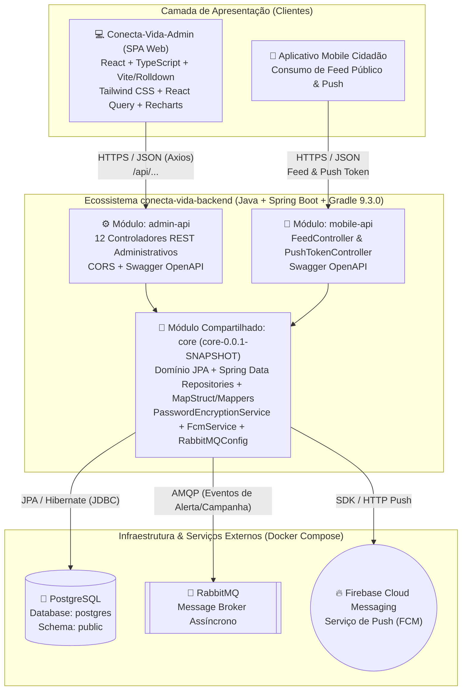
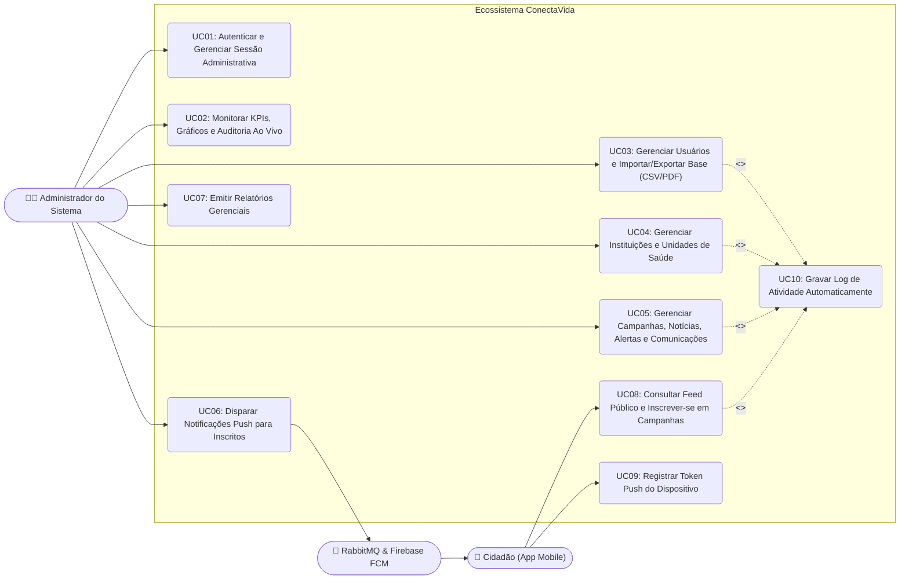
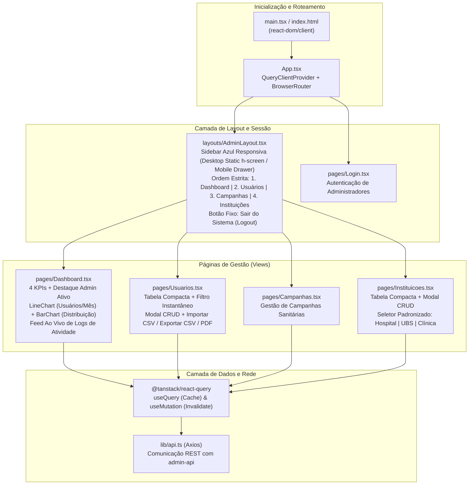
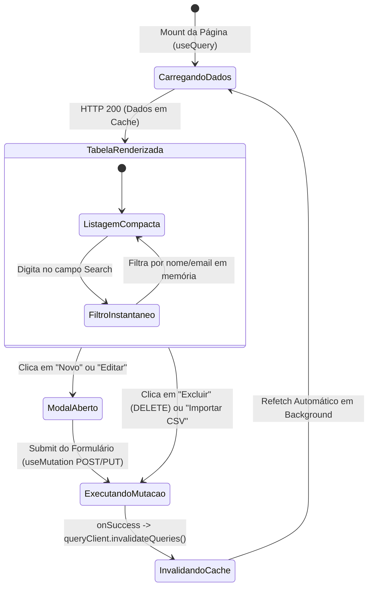

# 🏥 Ecossistema ConectaVida — Documento de Arquitetura de Software (SAD)

**Domínio Base:** `br.edu.ifsp.conectaavida`[cite: 3]  
**Repositórios Integrados:** `conecta-vida-backend` (Multi-Module Spring Boot API) & `Conecta-Vida-Admin` (SPA React + TypeScript)[cite: 2, 3]  
**Nível da Especificação:** Engenharia de Software Sênior (RFC / C4 Model / UML)

---

## 📚 Navegação da Documentação
Este portal técnico está dividido em três documentos complementares para facilitar o *onboarding* e a manutenção pelos desenvolvedores da equipe:

1. 📖 **[Visão Geral e Arquitetura Macro (Este Documento)](#1-visão-executiva-e-contexto-do-sistema)**
2. ⚙️ **[Especificação Técnica da API e Backend (`API_BACKEND.md`)](./API_BACKEND.md)** — Detalhamento dos módulos `core`, `admin-api` e `mobile-api`, entidades JPA, controladores REST, mensageria RabbitMQ e Firebase[cite: 3].
3. 💻 **[Especificação Técnica do Painel Administrador (`ADMIN_FRONTEND.md`)](./ADMIN_FRONTEND.md)** — Detalhamento da SPA em React, gerenciamento de estado com TanStack React Query, gráficos Recharts, tabelas compactas e fluxos CRUD[cite: 2].

---

## 1. Visão Executiva e Contexto do Sistema

O **ConectaVida** é uma plataforma distribuída voltada à gestão de saúde pública, divulgação de campanhas sanitárias, emissão de alertas epidemiológicos/emergenciais, publicação de notícias, credenciamento de instituições de saúde (Hospitais, UBS e Clínicas) e acompanhamento analítico auditável em tempo real[cite: 2, 3].

A arquitetura resolve o problema de acoplamento entre canais de gestão e canais de leitura pública adotando o padrão **BFF (*Backend for Frontend*) sobre um Monólito Modular Gradle**, separando o tráfego administrativo (`admin-api`) do tráfego de cidadãos móveis (`mobile-api`), enquanto compartilha um núcleo único de domínio, segurança e persistência (`core`)[cite: 3].

---

## 2. Diagrama de Arquitetura Macro (C4 Model — Visão de Containers)



---

## 3. Matriz Tecnológica do Ecossistema

| Camada | Tecnologia / Ferramenta | Versão / Artefato | Responsabilidade Arquitetural |
| --- | --- | --- | --- |
| **Build & Orquestração Backend** | Gradle Wrapper | `9.3.0` | Automação de build multi-módulo (`core`, `admin-api`, `mobile-api`).

 |
| **Framework Backend** | Spring Boot (Web, Data JPA, Security/Crypto, AMQP) | `0.0.1-SNAPSHOT` | Injeção de dependência, exposição REST, transações e ORM.

 |
| **Banco de Dados Relacional** | PostgreSQL | Schema `public` | Persistência transacional de usuários, instituições, comunicações e logs.

 |
| **Mensageria & Push** | RabbitMQ + Firebase (FCM) | `RabbitMQConfig` / `FcmService` | Desacoplamento de disparos em massa e notificações push móveis.

 |
| **Mapeamento de Dados** | Processador de Anotações (`UsuarioMapper`) | `UsuarioMapperImpl` | Conversão segura Entidade $\leftrightarrow$ DTO em tempo de compilação.

 |
| **Bundler & Linter Frontend** | Vite + Rolldown + Oxlint | `.oxlintrc.json` + `tsc` | Bundling de alta performance e análise estática em TypeScript.

 |
| **UI & Estado Assíncrono** | React + `@tanstack/react-query` + Axios | SPA (`conecta-vida-admin`) | Cache reativo de estado de servidor, mutações e invalidação automática.

 |
| **Visualização & Design** | Tailwind CSS + Recharts + Lucide React | Responsivo Desktop/Mobile | Tabelas compactas, sidebar fixa azul e gráficos analíticos SVG.

 |

---

## 4. Diagrama Geral de Casos de Uso do Ecossistema (UML)



---

## 5. Requisitos Globais Não Funcionais (RNFs Macro)

* **RNF-G01 — Isolamento de Superfície de Ataque (BFF Pattern):** Rotas administrativas de escrita e exclusão (`admin-api`) são fisicamente separadas da API pública consumida pelos dispositivos móveis (`mobile-api`), permitindo políticas de *rate-limiting*, firewall e escalonamento independentes.


* **RNF-G02 — Paridade de Ambiente via Infraestrutura como Código:** O arquivo `docker-compose.yml` na raiz do backend padroniza o provisionamento do banco PostgreSQL e dos serviços auxiliares para todos os desenvolvedores da equipe.


* **RNF-G03 — Rastreabilidade e Auditoria Completa:** Qualquer alteração crítica de estado no sistema gera um registro na entidade `LogAtividade`, garantindo transparência operacional em saúde pública.


```


---

# 📄 DOCUMENTO 3: Focado no Administrador (`ADMIN_FRONTEND.md`)

> **📋 Copie tudo abaixo e cole no seu arquivo `ADMIN_FRONTEND.md`:**

```markdown
# 💻 Especificação Técnica do Painel Administrador (`Conecta-Vida-Admin`)

**Diretório Base:** `Conecta-Vida-Admin/conecta-vida-admin`[cite: 2]  
**Branches Registradas:** `main`, `conecta-vida-admin-V2`[cite: 2]  
**Stack Principal:** React + TypeScript + Vite/Rolldown + Tailwind CSS + TanStack React Query + Recharts + Axios + Lucide React + Oxlint[cite: 2]

---

## 1. Arquitetura Interna do Frontend (SPA)

O projeto `Conecta-Vida-Admin` foi arquitetado como uma **Single Page Application (SPA)** modular focada em alta densidade visual, responsividade híbrida (Desktop/Mobile) e sincronização reativa de estado de servidor (*Server State*)[cite: 2].



---

## 2. Organização da Arquitetura de Pastas

```text
Conecta-Vida-Admin/conecta-vida-admin/
 ├── .oxlintrc.json               # Regras de linting ultrarrápido (Oxlint)
 ├── index.html                   # Ponto de entrada HTML da SPA
 ├── src/
 │   ├── lib/
 │   │   └── api.ts               # Instância Axios configurada para a admin-api
 │   ├── layouts/
 │   │   └── AdminLayout.tsx      # Layout mestre com Sidebar Azul e Logout fixo
 │   ├── pages/
 │   │   ├── Dashboard.tsx        # Painel Analítico (Recharts + Logs Ao Vivo)
 │   │   ├── Usuarios.tsx         # Gestão de Usuários (Tabela Compacta + CSV/PDF)
 │   │   ├── Campanhas.tsx        # Gestão de Campanhas
 │   │   ├── Instituicoes.tsx     # Gestão de Instituições (Hospital / UBS / Clínica)
 │   │   └── Login.tsx            # Tela de Login Administrativo
 │   ├── App.tsx                  # Árvore de Rotas e Provider do React Query
 │   └── main.tsx                 # Bootstrap do React DOM

```

---

## 3. Engenharia de Interface e Decisões Técnicas de UI/UX

### 3.1. Barra Lateral e Controle de Viewport (`AdminLayout.tsx`)

* **Sequência Estrita de Navegação:** Os itens do menu lateral são renderizados na ordem imutável definida pela arquitetura de produto:
1. **Dashboard** (`/`)
2. **Usuários** (`/usuarios`)
3. **Campanhas** (`/campanhas`)
4. **Instituições** (`/instituicoes`)


* **Persistência Visual do Botão de Logout:** O elemento `<aside>` utiliza `fixed lg:static inset-y-0 left-0 h-screen` sem conflito de propriedades CSS (`cssConflict` eliminado entre `fixed` e `sticky`). Isso garante que, mesmo quando a tabela de usuários ou campanhas possuir mais de 1.000 linhas, o menu lateral não role junto com a página e o botão **"Sair do Sistema"** permaneça sempre visível no canto inferior esquerdo.
* **Design Adaptativo Mobile (Drawer):** Em telas menores (`< lg`), a barra lateral recolhe-se fora do ecrã (`-translate-x-full`) e exibe uma barra superior (`header`) com botão hambúrguer (`Menu`) e fundo escuro (`bg-black/50`) ao abrir.

### 3.2. Dashboard Analítico e Estabilidade de Grid (`Dashboard.tsx`)

* **Prevenção de Quebra de Layout (Zoom e Redimensionamento):** Todos os containers Flex e Grid principais aplicam `min-w-0` e `overflow-x-hidden`. Isso corrige o problema clássico do `ResponsiveContainer` do **Recharts** onde gráficos SVG expandem indefinidamente ou cortam a tela ao aplicar zoom.


* **Prioridade Visual dos Gráficos:**
1. **Topo Esquerdo (`lg:col-span-2`):** Gráfico de Linha (`LineChart`) exibindo a **Entrada de Novos Usuários por Mês**.
2. **Base Esquerda (`lg:col-span-2`):** Gráfico de Barras (`BarChart`) exibindo a **Distribuição Geral do Sistema**.
3. **Coluna Direita (`lg:col-span-1`):** Feed **Ao Vivo de Logs de Atividade**, com cartões individuais onde o texto longo da ação utiliza `break-all whitespace-normal` para nunca vazar para fora da caixa.


### 3.3. Tabelas Compactas, Modais CRUD e Lotes (`Usuarios.tsx` & `Instituicoes.tsx`)

* **Densidade Visual Compacta:** As tabelas foram refinadas com cabeçalhos `py-2.5 px-4 text-[11px] uppercase` e células `py-3 px-4 text-xs`, eliminando espaços em branco exagerados.
* **Seletor Padronizado de Instituição:** O modal de criação/edição em `Instituicoes.tsx` restringe o campo `tipoInstituicao` através de um `<select>` com as opções **Hospital**, **UBS** e **Clínica**.
* **Operações de Importação e Exportação em `Usuarios.tsx`:**
* **Importar CSV:** Utiliza `FileReader` nativo para ler planilhas `.csv` selecionadas pelo administrador, iterando sobre as linhas e disparando requisições `POST /api/usuarios` antes de invalidar o cache do React Query.
* **Exportar CSV:** Converte a lista de usuários em memória para um objeto `Blob` (`text/csv;charset=utf-8;`) e inicia o download automático de `usuarios_conectavida_YYYY-MM-DD.csv`.
* **Imprimir / Exportar PDF:** Aciona a geração de documento via `window.print()`.


---

## 4. Diagrama de Estados e Mutações na Interface (`Usuarios.tsx` / `Instituicoes.tsx`)



---

## 5. Casos de Uso e Requisitos do Painel Administrador

### 5.1. Especificação de Casos de Uso (Frontend)

| Código | Caso de Uso | Ator | Fluxo Principal na Interface |
| --- | --- | --- | --- |
| **UC-ADM-01** | **Inspecionar Indicadores e Auditoria** | Administrador | Acessa `/`, visualiza os 4 cartões de resumo, identifica o administrador mais ativo no topo, analisa os gráficos Recharts e acompanha os logs em tempo real.

 |
| **UC-ADM-02** | **Cadastrar e Editar Usuários via Modal** | Administrador | Em `/usuarios`, clica em *Novo Utilizador* ou *Editar*, preenche Nome, E-mail, Senha e Permissão (`COMUM` ou `ADMIN`) e salva sem recarregar a página. |
| **UC-ADM-03** | **Importar e Exportar Base de Usuários** | Administrador | Em `/usuarios`, utiliza os botões *Importar CSV*, *Exportar CSV* ou *Imprimir / PDF* no cabeçalho para interoperar com planilhas externas. |
| **UC-ADM-04** | **Gerenciar Instituições de Saúde** | Administrador | Em `/instituicoes`, cadastra ou edita instituições selecionando o tipo entre **Hospital**, **UBS** ou **Clínica**, ou remove registros com confirmação de segurança. |
| **UC-ADM-05** | **Encerrar Sessão / Trocar de Usuário** | Administrador | Clica no botão fixo *Sair do Sistema* na base da barra lateral em qualquer altura de rolagem; o sistema limpa `token` e `user` do `localStorage` e redireciona para `/login`. |

### 5.2. Requisitos Funcionais do Painel (RF-UI)

* **RF-UI-01:** Exibir menu lateral azul com destaque ativo e ordem fixa: *Dashboard*, *Usuários*, *Campanhas* e *Instituições*.
* **RF-UI-02:** Permitir filtragem instantânea por texto (nome ou e-mail) nas tabelas de Usuários e Instituições.
* **RF-UI-03:** Fornecer modais de criação e edição com feedback visual de carregamento (`isPending` -> *"A salvar..."*).
* **RF-UI-04:** Suportar importação de arquivos `.csv` e exportação em `.csv` e PDF diretamente na tela de usuários.

### 5.3. Requisitos Não Funcionais do Painel (RNF-UI)

* **RNF-UI-01 (Responsividade Mobile-First e Desktop):** O painel deve operar perfeitamente tanto em monitores widescreen quanto em smartphones de administradores em campo, alternando entre sidebar estática (`lg:static`) e menu retrátil (`fixed` com *backdrop*).
* **RNF-UI-02 (Zero-Reload State Sync):** Configurado com `refetchOnWindowFocus: false` e `retry: 1` no `QueryClient`, garantindo atualização reativa das tabelas apenas quando mutações (`useMutation`) forem concluídas com sucesso.


* **RNF-UI-03 (Qualidade de Código e Tipagem Estrita):** Validado estaticamente via **TypeScript** (`tsc`) e **Oxlint** (`.oxlintrc.json`), assegurando interfaces tipadas (`Usuario`, `Instituicao`, `DashboardStats`) e ausência de conflitos de classes Tailwind CSS.


```

```
